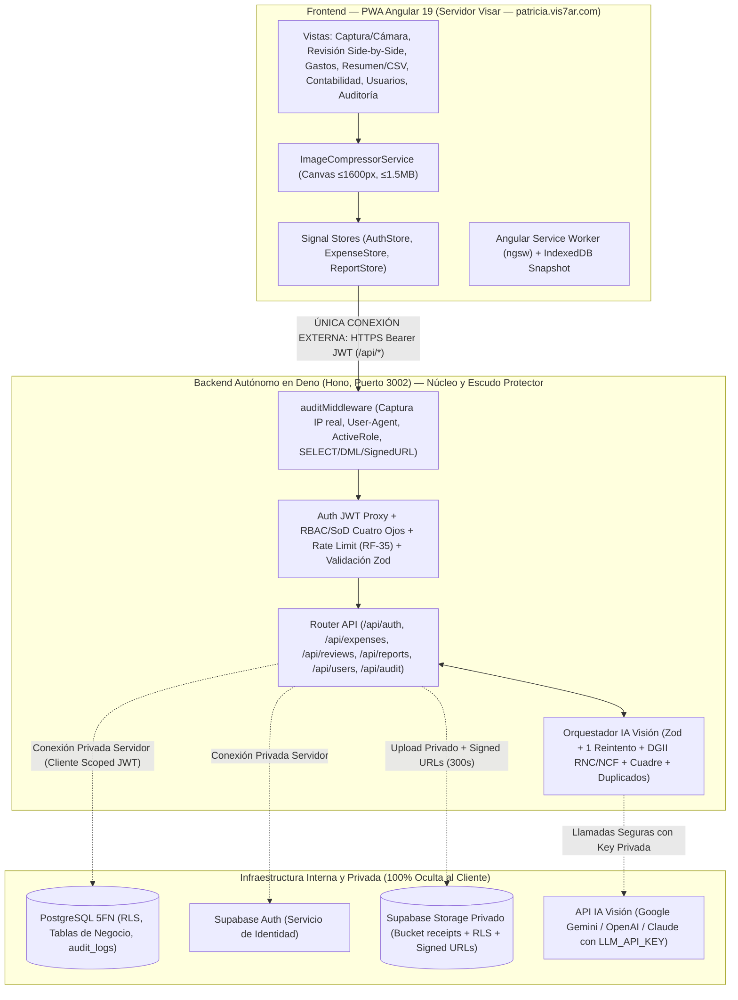
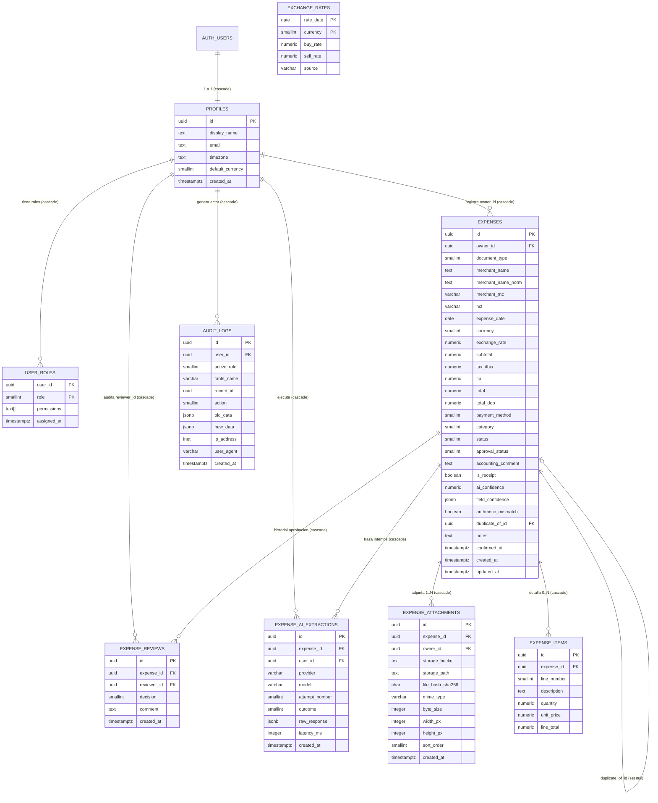
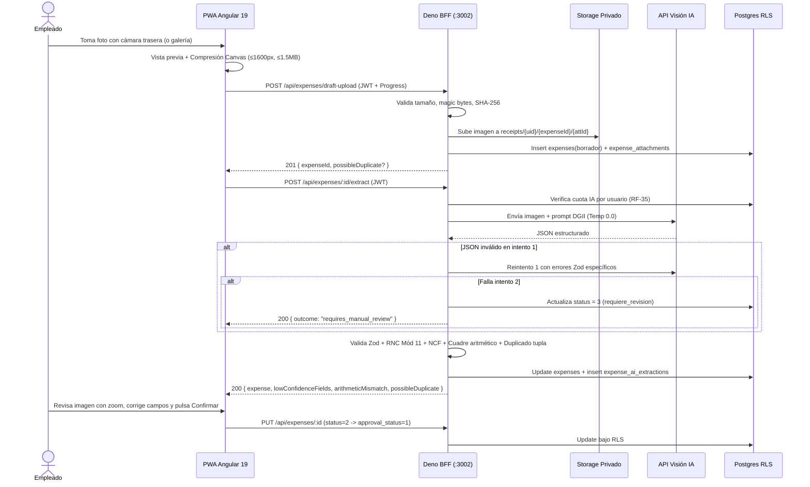

# Documento de Análisis Técnico y Plan de Ejecución — Prueba 2: Escáner de recibos con IA (PWA)

> Fuente: `Prueba2_Escaner_Recibos_con_IA.md` (19-nov-2026). Time-box: **8 h** (incluye 30 min de plan).

---

## 1. Resumen Ejecutivo y Restricciones Críticas

### 1.1 Objetivo (≤3 líneas)
PWA móvil *mobile-first* donde un colaborador fotografía **recibos o facturas**, una **IA con visión** extrae el tipo de documento (`Recibo` vs `Factura Fiscal`) y los datos fiscales dominicanos (`DOP`, `ITBIS 18%`, `RNC`, `NCF`) validados con Zod, el usuario los revisa junto a la imagen y se guardan en **Supabase Cloud** bajo un esquema de **3 roles con permisos granulares** (`Empleado`, `Contador` y `Super Admin`). La solución opera mediante un BFF autónomo en Deno/Hono (puerto `3002`, coexistiendo en Visar con Nora en `3001`) y se publica en producción en `https://patricia.vis7ar.com` con Nginx nativo sin Docker.

### 1.2 Restricciones

| Tipo | Restricción | Fuente |
|---|---|---|
| Tiempo | 8 h máximo; 30 min iniciales de plan; cambio sorpresa a las 3:30 h | Reglas |
| Stack obligatorio | **Supabase Cloud (Postgres 5FN + Auth + Storage privado)**; frontend Angular 19 PWA + Backend Deno/Hono BFF | Reglas, Definición |
| Seguridad / IA | La llave de IA (`LLM_API_KEY`) **nunca** en el navegador → Backend Deno/Hono / Edge Function (RF-10) | Reglas, RF-10 |
| Seguridad / RLS | Usuario A no ve ni modifica gastos de usuario B, **ni llamando la API directamente** (RF-02) | RF-02 |
| Seguridad / RBAC | Modelo de **3 roles (`Empleado`, `Contador`, `Super Admin`) + permisos granulares (`modulo:accion`) por usuario**: solo **Super Admin** tiene acceso total y administra usuarios/roles/permisos y auditoría; **Contador** solo revisa, comenta y dictamina en Contabilidad (sujeto a SoD Cuatro Ojos) | RF-04, CS-01, Req. Arq |
| Seguridad / Storage | Bucket `receipts` privado; las fotos **solo** se visualizan mediante URL firmada temporal y solo por su dueño, Contador o Super Admin autorizado (RF-03) | RF-03, CS-01 |
| Auditoría | Desacoplada en la capa de aplicación con **middleware en Hono** (`auditMiddleware`) no bloqueante (`EdgeRuntime.waitUntil()` / ejecución asíncrona); **cero triggers SQL** de auditoría para evitar contención y permitir auditar `SELECT`, generación de Signed URLs, comentarios y exportaciones CSV con IP y `User-Agent` | Decisión Arq |
| Arquitectura IA | Salida JSON validada contra esquema **Zod** incluyendo `document_type` (`recibo` \| `factura`); ante JSON inválido reintenta **1 vez** y si vuelve a fallar el gasto queda en estado `requiere_revision` (RF-12); si no es un recibo/factura o es ilegible deja los campos vacíos sin inventar datos (RF-15) | RF-12, RF-14, RF-15 |
| Contexto Fiscal RD | Moneda por defecto `DOP`, `ITBIS` de 18 %, diferenciación entre **Factura Fiscal** (RNC/NCF obligatorios y validados) y **Recibo** (RNC/NCF opcionales), algoritmo Módulo 11 (`RNC`/`Cédula`) y formato `NCF` Serie B / `e-CF` Serie E (DGII) | Reglas, RF-11 |
| Compresión y Costos | Compresión en cliente antes de subir: **≤ 1600 px por lado y ≤ 1.5 MB** (RF-07); límite de procesamientos IA por usuario en backend (RF-35) | RF-07, RF-35 |
| Despliegue Frontend & BFF | Servidor Visar Ubuntu (`159.203.103.8`, `vis7ar.com`) con Nginx nativo (**0 Docker**) en `https://patricia.vis7ar.com` (SSL Certbot) + servicio `systemd` Deno en **puerto `3002`** (coexistiendo con Nora en `3001`) | RF-33, DevOps |
| Despliegue Backend / BD | Script `deploy-backend.ps1`: aplica migraciones (`supabase db push`), soporta semillas idempotentes bajo demanda (`-WithSeed` vía `run-seed.ts`) y publica Edge Functions | RF-34, DevOps |
| Código y Alcance | Git con commits frecuentes; esquema SQL versionado que recrea tablas, políticas RLS y bucket Storage desde cero (RF-34); "menos y funcionando" > "mucho a medias" | Reglas, RF-34 |

### 1.3 Decisión de stack y arquitectura visual (ADR-01)
- **Frontend:** Angular 19 (**100 % Standalone + Signals + `ChangeDetectionStrategy.OnPush`** + control flow nativo `@if`/`@for`/`@switch` + Tailwind CSS) configurado como PWA instalable (`manifest.webmanifest`, íconos 192/512 + maskable, `@angular/pwa` con `ngsw`).
  - **4 Capas Modulares (`features -> layout -> shared -> core`):** Dependencia estricta hacia adentro y prohibición de imports cruzados entre *features*. Servicios HTTP heredan de `BaseApiService` y stores reactivos heredan de `SignalStoreBase<TState>`.
  - **Auth JWT + Refresh Single-Flight + RBAC Multi-Rol + Permisos Granulares + SoD:** `jwtAuthInterceptor` (inyecta `Authorization: Bearer` y `X-Active-Role`) + `refreshTokenInterceptor` con cola `BehaviorSubject` ante `401`. Cada usuario posee un **rol asignado** (`1=Empleado`, `2=Contador`, `3=Super Admin`) y un **arreglo explícito de permisos granulares (`permissions[]`)** verificados en frontend mediante `*appHasPermission` y en backend por middleware. Aplica **Principio de Cuatro Ojos (SoD)** (`ownerId !== reviewerId`): un Contador jamás puede aprobar ni rechazar un recibo/factura propio; solo otro Contador o el **Super Admin** puede dictaminarlo.
  - **Estándar Monetario (`<app-currency-input>` y `MoneyPipe`):** Prohibido usar `<input type="number">` para importes financieros (`subtotal`, `tax_itbis`, `tip`, `total`, `exchange_rate`, `unit_price`). Toda captura monetaria usa `<app-currency-input>` (`ControlValueAccessor`, `font-mono tabular-nums`) y toda lectura usa `MoneyPipe` (`{{ item.total | money:item.currencyCode }}`).
  - **Repositorio Tipado de Iconos SVG (`PATRICIA_ICON_CATALOG` + `<app-icon>`):** Prohibido incrustar `<svg>` inline sueltos en plantillas; todos los trazos viven centralizados en `IconRegistryService`.
  - **Experiencia Mobile-First (360 px) & Pantalla de Revisión:** Captura con cámara trasera (`capture="environment"`) y fallback explicativo a galería, vista previa con opción de repetir, compresión automática en cliente (`Canvas`/`createImageBitmap`), subida con indicador de progreso real y reintento, y pantalla de revisión con selector de tipo (**Recibo** vs **Factura Fiscal**), visor ampliable junto al formulario editable con **campos dudosos resaltados**, **cuadre aritmético reactivo** y **alerta de posible duplicado**.
  - **Ficha Estándar del Gasto, Comentarios Contables y Trazabilidad Detallada:** Vista de detalle unificada con badge de tipo (`📄 Factura Fiscal` / `🧾 Recibo`), zoom/rotación en la imagen original, **visualización directa del comentario de Contabilidad dentro de la pantalla de Gastos**, y botón **"Ver información detallada"** para inspeccionar: quién registró el gasto, fecha/hora exacta, origen/canal (Cámara PWA vs Galería + Visión IA vs Manual), score de confianza y reintentos Zod, dictamen de Contabilidad (aprobador, fecha y comentario), IP y `User-Agent`.
  - **Bandeja de Contabilidad con Inspección Integral (CS-01):** Cada recibo o factura en Contabilidad incluye el botón **"Ver información capturada y recibo/factura"** que abre un visor lado a lado / modal con la imagen ampliable (zoom/rotación) y todos los campos capturados (RNC, NCF, subtotal, ITBIS, propina, total, líneas de detalle y confianza IA), junto con la caja de **comentarios contables** (al aprobar, observar o rechazar) que se muestran inmediatamente en la pantalla de **Gastos**.
  - **Módulo Super Admin (Usuarios, Roles, Permisos y Auditoría):** Exclusivo para el rol **Super Admin (`3`)**, quien cuenta con todos los accesos (`*:*`), gestiona usuarios (crear, editar rol y activar/desactivar permisos granulares por usuario, borrar en cascada con confirmación modal) y consulta el visor paginado de `audit_logs`.
- **Backend en Deno (Hono Framework) como Núcleo Autónomo y Escudo Protector (BFF — Puerto `3002`):**
  - **Cero Exposición Directa de Supabase al Cliente:** El frontend Angular **nunca se comunica directamente con Supabase (ni PostgREST, ni Auth SDK, ni Storage)**. Solo conoce `https://patricia.vis7ar.com/api/*`.
  - **Defensa en Profundidad (BFF + RLS Nativo):** El BFF Deno valida el JWT, resuelve rol + permisos granulares del usuario y crea un cliente Supabase **scoped al JWT del usuario** (`getSupabaseForRequest(c)`) para todas las operaciones de datos y emisión de Signed URLs. Así, **incluso si alguien llama directamente a la API REST o Storage de Supabase con el JWT de A, las políticas RLS bloquean todo acceso a gastos o fotos de B** (RF-02, RF-03).
  - **Orquestación de Visión IA y Reglas DGII:** Valida tamaño/MIME/magic bytes, calcula hash `SHA-256` de imagen para duplicados, invoca el modelo con visión (Google Gemini / OpenAI / Claude con `LLM_API_KEY` privada), valida el JSON contra **Zod** (clasificando `document_type: 'recibo' | 'factura'`) con 1 reintento automático, aplica validadores deterministas de `RNC` (Módulo 11), `NCF/e-CF` y cuadre aritmético, y aplica rate limit por usuario (`RF-35`).
- **Despliegue Cohesionado en Servidor Visar (0 Docker):** Nginx en `159.203.103.8` sirve la PWA Angular en `/` (`https://patricia.vis7ar.com`) y enruta `/api/*` hacia el servicio `systemd` Deno en `127.0.0.1:3002` (dejando `3001` intacto para Nora).
- **Auditoría Desacoplada por Middleware (0 Triggers SQL):** `auditMiddleware` en Hono registra `INSERT`, `UPDATE`, `DELETE`, `SELECT` sensibles, generación de Signed URLs, cambios de permisos y exportaciones CSV con `ip_address` (`inet`), `user_agent` y `active_role` sin bloquear la respuesta HTTP.
- **Enums:** `smallint` enteros fijos con constraints `CHECK` en PostgreSQL, mapeados 1:1 a contratos tipados `as const` en TypeScript.

### 1.4 Criterios de evaluación / éxito
1. **Almacenamiento y seguridad:** Auth con Supabase, aislamiento RLS verificable con 2 usuarios y llamadas REST directas, bucket privado `receipts` con URLs firmadas, llave de IA fuera del navegador y segregación de accesos por rol y permisos granulares (`Empleado`, `Contador`, `Super Admin`).
2. **Cámara en una PWA y experiencia móvil:** Cámara trasera con fallback educativo a galería, vista previa/repetir, compresión cliente (≤1600 px / ≤1.5 MB), progreso de subida con reintento, diseño 360 px, instalable y modo offline básico.
3. **Visión con salida estructurada y validada:** Distinción correcta entre **Recibo** y **Factura Fiscal**, ≥7 campos correctos en comprobante nítido (contexto RD: `DOP`, `ITBIS 18%`, `RNC`, `NCF`), validación Zod con 1 reintento y estado `requiere_revision`, categoría sugerida editable y detección de imagen no-recibo/ilegible sin inventar datos.
4. **Pantalla de revisión y bandeja contable:** Imagen ampliable junto a formulario editable precargado, campos con baja confianza resaltados, alerta aritmética, aviso de duplicado, inspección contable completa desde Contabilidad y comentarios visibles en Gastos.
5. **Gestión de alcance y comunicación:** Plan inicial de 30 min, priorización MVP vs deseables, respuesta ordenada al cambio sorpresa (CS-01 + Super Admin), commits frecuentes, README honesto, video 3–5 min y revisión en vivo de 20 min.

---

## 2. Matriz de Trazabilidad y Priorización (MVP vs. Backlog)

### 2.1 Bloque A — Alcance Crítico (MVP / Obligatorios)

| ID | Módulo | Requerimiento | Riesgo | Dependencias |
|---|---|---|---|---|
| RF-01 | Auth | Registro, inicio de sesión y cierre de sesión con Supabase Auth (vía BFF `/api/auth`) | Bajo | — |
| RF-02 | Seguridad/BD | Políticas RLS en `expenses`, `expense_items`, `expense_attachments` y `expense_reviews` (verificable vía API directa) | **Alto** | RF-01, RF-34 |
| RF-03 | Seguridad/Storage | Bucket `receipts` privado con políticas RLS de Storage; fotos visibles solo con URL firmada | **Alto** | RF-01, RF-34 |
| RF-05 | Captura | Tomar foto con cámara trasera del celular o elegir de galería; si se niega el permiso, ofrece galería y explica por qué | Medio | RF-28 |
| RF-06 | Captura | Vista previa de la foto antes de procesarla con opción de repetir/descartar | Bajo | RF-05 |
| RF-07 | Captura | Reducir y comprimir la imagen en el cliente antes de subirla (**≤ 1600 px** por lado y **≤ 1.5 MB**) | Medio | RF-06 |
| RF-08 | Captura | Subir imagen a Supabase Storage con indicador de progreso real y error con opción de reintentar | Medio | RF-07, RF-03 |
| RF-10 | Extracción IA | Envío de la imagen al modelo con visión desde el Backend Deno/Hono (llave nunca en navegador) | Medio | RF-08 |
| RF-11 | Extracción IA | Campos extraídos: tipo (**recibo o factura**), comercio, fecha, moneda, subtotal, impuesto (ITBIS), propina, total, método de pago, RNC y NCF cuando existan (≥7 correctos en comprobante nítido) | **Alto** | RF-10 |
| RF-12 | Extracción IA | Respuesta JSON validada contra esquema **Zod**; si es inválido reintenta **1 vez** y si falla queda en estado `requiere_revision` | **Alto** | RF-10 |
| RF-13 | Extracción IA | Categoría sugerida (`alimentos`, `combustible`, `transporte`, `oficina`, `servicios`, `otros`) editable | Bajo | RF-11 |
| RF-14 | Extracción IA | Nivel de confianza por campo y campos dudosos resaltados en pantalla de revisión | Medio | RF-11, RF-12 |
| RF-15 | Extracción IA | Detección de imagen que no es un recibo/factura o es ilegible: mensaje claro, campos vacíos, nunca inventa datos | Medio | RF-10, RF-12 |
| RF-16 | Validación | Validación aritmética (`subtotal + impuesto + propina == total`); avisa en servidor y UI si no coincide | Bajo | RF-11, RF-18 |
| RF-18 | Revisión | Pantalla de revisión con la imagen junto a formulario editable precargado (incluyendo selector **Recibo vs Factura**) | Medio | RF-11, RF-14 |
| RF-19 | Gastos | Estados del gasto: `borrador`, `confirmado` y `requiere_revision`; solo confirmados (y aprobados tras CS-01) cuentan | Bajo | RF-18 |
| RF-20 | Validación | Aviso de posible duplicado por tupla `(comercio, fecha, total)`, `(RNC, NCF)` o hash `SHA-256` de imagen | Medio | RF-08, RF-11 |
| RF-21 | Gastos | Editar y eliminar un gasto (pide confirmación modal y elimina la imagen física de Storage) | Medio | RF-03, RF-19 |
| RF-22 | Listado | Lista de gastos con miniatura (Signed URL), badge **Recibo/Factura**, comentario de Contabilidad visible, comercio, fecha, total (`MoneyPipe`) y categoría desc | Bajo | RF-19, RF-03 |
| RF-23 | Listado | Filtros combinables por rango de fechas, tipo (**recibo/factura**), categoría, estado y búsqueda por comercio/RNC | Bajo | RF-22 |
| RF-24 | Detalle | Detalle del gasto con imagen original ampliable (zoom táctil + rotación) | Bajo | RF-03, RF-22 |
| RF-25 | Reportes | Resumen del mes: total y total por categoría con un gráfico simple | Bajo | RF-19, CS-01 |
| RF-26 | Reportes | Exportar a CSV el rango seleccionado (abre limpio en Excel con tildes UTF-8 BOM y columnas separadas) | Bajo | RF-23 |
| RF-28 | UI/Móvil | Diseño *mobile-first* usable en **360 px** de ancho, controles táctiles ≥44 px, sin scroll horizontal | Bajo | — |
| RF-29 | PWA | App instalable: `manifest.webmanifest`, íconos 192 y 512 px (+maskable), service worker `ngsw` standalone | Bajo | RF-33 (HTTPS) |
| RF-30 | PWA/Offline | Modo sin conexión básico: abre offline y muestra los gastos ya cargados desde IndexedDB con aviso | Medio | RF-22, RF-29 |
| RF-32 | UI | Estados de carga (*skeleton*), vacío y error con reintento en todas las pantallas | Bajo | Todas las vistas |
| RF-33 | DevOps | Publicación en URL pública en Servidor Visar (`https://patricia.vis7ar.com`) con Nginx nativo (0 Docker) y Deno puerto `3002` | Medio | — |
| RF-34 | DevOps/BD | Esquema de BD (5FN + RLS + Storage) versionado en `supabase/migrations/` recreable desde cero | Bajo | — |
| **CS-01** *(absorbe RF-04)* | Sorpresa / RBAC | **Rol Contador**: ve gastos de todos, filtra por colaborador, dispone de botón **"Ver información capturada y recibo/factura"** (visor zoom + campos extraídos + caja de comentario contable), aprueba/observa/rechaza publicando comentarios visibles en Gastos; **SoD Cuatro Ojos** (`owner_id ≠ reviewer_id`) | **Alto** | RF-02, RF-03, RF-19 |
| **RF-RBAC-ADM** | Seguridad / RBAC | **Rol Super Admin (`role = 3`) + Permisos Granulares**: acceso total (`*:*`), gestiona colaboradores, asigna roles (`Empleado`, `Contador`, `Super Admin`) y permisos por usuario (`modulo:accion`), y resuelve aprobaciones bloqueadas por SoD al Contador | **Alto** | RF-02, CS-01 |
| RF-EXP-STD | Detalle | Ficha estándar del gasto con botón **"Ver información detallada"** (creador, tipo Recibo/Factura, fecha/hora exacta, origen Cámara/Galería/IA, dictamen y comentario contable, IP/User-Agent) | Bajo | RF-24, RF-AUDIT |
| RF-USR-CRUD | Admin | Módulo CRUD de Gestión de Usuarios, Roles y Permisos exclusivo para **Super Admin** (crear usuarios, editar rol/permisos granulares, vista de gastos por colaborador y borrado en cascada con confirmación modal) | Medio | RF-02, RF-RBAC-ADM |
| RF-AUDIT | Seguridad/BD | Bitácora `audit_logs` poblada por `auditMiddleware` en Deno (**0 triggers SQL**); consulta paginada y filtrable exclusiva para **Super Admin** | Medio | RF-02, RF-34 |
| RF-MONEY | UI/Estándar | Captura monetaria estandarizada con `<app-currency-input>` y visualización con `MoneyPipe` (`font-mono tabular-nums`) | Bajo | RF-18, RF-22 |
| RF-ICONS | UI/Estándar | Catálogo tipado `PATRICIA_ICON_CATALOG` e `IconRegistryService` (`<app-icon>`) | Bajo | RF-28 |

### 2.2 Bloque B — Alcance Secundario (Deseables / Post-MVP), en orden de valor/costo

| Orden | ID | Módulo | Requerimiento | Riesgo | Dependencias | Justificación |
|---|---|---|---|---|---|---|
| 1 | RF-35 | Seguridad/Costos | Control de costos IA: límite de tamaño (1.5 MB / 10 MB Nginx) y cuota de procesamientos por usuario | Bajo | `expense_ai_extractions` | Muy barato (consulta de conteo en ventana) y evita abuso de API de visión |
| 2 | RF-TESTS | Calidad | Suite de tests Deno/Angular (Zod, `validateRncModulo11`, `validateNcfDgii`, cuadre aritmético, CSV BOM, SoD) | Bajo | RF-12, RF-16, CS-01 | Respalda el criterio de salida validada y agiliza la revisión en vivo |
| 3 | ALT-01 | Finanzas | Soporte de gastos en **USD y DOP** con tasa de cambio editable y equivalente `total_dop` | Bajo | `expenses.exchange_rate` | Si el esquema nace con `currency` y `exchange_rate` en `0001`, el esfuerzo UI es ~30 min |
| 4 | RF-17 | Extracción IA | Líneas de detalle (`expense_items`: descripción, cantidad, precio) guardadas en tabla relacionada | Medio | RF-11, RF-18 | Útil contablemente, pero el editor de líneas en pantalla de 360 px añade ~45 min |
| 5 | RF-09 / ALT-02 | Captura | Varias fotos o un PDF por gasto (recibos largos) | Medio | `expense_attachments` | La BD en 5FN ya soporta `1:N`; requiere flujo multi-página en captura y prompt multi-imagen |
| 6 | RF-27 | Agente | Preguntas en lenguaje natural sobre los gastos ("¿Cuánto gasté en combustible este mes?") | **Alto** | RF-25, Deno LLM | Exige segundo orquestador de *tool calling* bajo RLS sin alucinar; se sacrifica ante desvío |
| 7 | RF-31 | PWA | Cola de captura sin conexión en IndexedDB que procesa al volver la red | **Alto** | RF-08, RF-30 | Propenso a *edge cases* de tokens expirados o memoria en móvil; último en prioridad |

---

## 3. Detección de Ambigüedades y Preguntas de Clarificación

| # | Tema | Pregunta al evaluador / Decisión de Diseño | Solución adoptada |
|---|---|---|---|
| Q1 | **Totales tras CS-01 (RF-19 vs CS-01)** | RF-19 dice "solo los confirmados cuentan", pero CS-01 indica que "Contabilidad necesita aprobar los gastos antes de que cuenten". ¿Cuál regla rige los totales? | Prevalece CS-01: el total oficial del Resumen del Mes (RF-25) suma **únicamente `status = confirmado AND approval_status = aprobado`**. Se muestra una tarjeta secundaria informativa con el acumulado `"Pendiente de aprobación"` para visibilidad operativa. |
| Q2 | **Segregación de Funciones SoD (CS-01)** | Si un usuario con rol Contador sube un gasto personal o operativo, ¿puede aprobarlo él mismo? | **No (Principio de Cuatro Ojos):** Se prohíbe tanto en la UI (`*appHasPermission` con `resourceOwnerId`) como en el backend (`403 SOD_VIOLATION`) y en trigger SQL (`reviewer_id <> owner_id`). Debe revisarlo otro Contador o el **Super Admin**. |
| Q3 | **Edición/Borrado de gasto aprobado (RF-21 + CS-01)** | ¿Puede el empleado editar o eliminar un gasto ya aprobado por Contabilidad? | **No:** Un gasto `aprobado` es inmutable para el empleado. Solo puede editar o eliminar gastos en estado `borrador`, `requiere_revision`, `pendiente_aprobacion` o `rechazado` (al corregir y re-confirmar un rechazado vuelve a `pendiente_aprobacion`). |
| Q4 | **Acceso del Contador y Super Admin a imágenes privadas (RF-03 + CS-01)** | RF-03 establece que las fotos solo las ve su dueño con URL firmada, pero Contabilidad y Super Admin deben verificar el recibo/factura físico. | Las políticas de `storage.objects` y el BFF permiten emitir Signed URLs (TTL 300 s) al dueño (`folder[1] = auth.uid()`), a un `Contador` o a un `Super Admin`, registrando la consulta en `audit_logs`. Un empleado B sigue bloqueado frente a fotos de A. |
| Q5 | **Permiso de cámara denegado y desktop (RF-05)** | Si el usuario deniega permisos de cámara o entra desde PC de escritorio, ¿cómo se comporta la captura? | Se ofrece botón principal de cámara trasera (`capture="environment"` / `getUserMedia`); ante `NotAllowedError` o ausencia de cámara, muestra mensaje explicativo claro y habilita de inmediato el selector de galería. |
| Q6 | **Tolerancia en cuadre aritmético e ITBIS (RF-16)** | En recibos dominicanos hay redondeos de centavos, ítems exentos (ITBIS < 18 %) o propina legal (10 %) incluida aparte. ¿El descuadre bloquea guardar? | **No bloquea:** Se evalúa `abs((subtotal + tax_itbis + tip) - total) <= 0.05`. Si hay diferencia, resalta el banner con el monto exacto de descuadre y un botón rápido `"Recalcular total"`, pero deja guardar si el usuario confirma. |
| Q7 | **Criterio de duplicado (RF-20)** | ¿Qué criterios disparan la advertencia de posible duplicado y si impide guardar? | **Advierte sin bloquear:** Evalúa (a) mismo `file_hash_sha256` en `expense_attachments`, (b) mismo par no nulo `(merchant_rnc, ncf)` o (c) misma tupla `(merchant_name_norm, expense_date, total)`. Muestra alerta enlazando el gasto previo. |
| Q8 | **Umbral de campos dudosos (RF-14)** | ¿Cuándo se resalta un campo en la pantalla de revisión? | Cuando la confianza del modelo IA para ese campo es `< 0.75`, **o** cuando falla validación determinista en servidor: `RNC` con Módulo 11 inválido, `NCF/e-CF` con formato DGII inválido (cuando es Factura Fiscal), o `expense_date` futura respecto a `America/Santo_Domingo`. |
| Q9 | **JSON inválido (RF-12) vs No-Recibo / Ilegible (RF-15)** | ¿Cómo reacciona cada escenario en UI y BD? | Si falla Zod en intento 1 → reintenta 1 vez con el error Zod; si vuelve a fallar → guarda la imagen en estado `requiere_revision` para captura manual. Si JSON es válido pero `is_receipt = false` o ilegible → fuerza campos fiscales a `null` (nunca inventa), avisa y ofrece `"Repetir foto"` o `"Llenar a mano"`. |
| Q10 | **Moneda por defecto y Bimoneda (ALT-01)** | ¿Cómo manejar recibos en USD frente a la moneda por defecto DOP? | `currency` (`1=DOP`, `2=USD`) y `exchange_rate` existen desde `0001_init.sql`. Para DOP la tasa es `1.0000`; para USD el usuario puede editar la tasa y `total_dop` (columna generada) consolida el Resumen del Mes sin mezclar monedas. |
| Q11 | **Zona horaria y cortes mensuales (RF-22, RF-25)** | ¿Cómo evitar saltos de mes o día por UTC? | Zona horaria `America/Santo_Domingo` (`UTC-4`). `expense_date` es tipo `date` calendario puro (sin desplazamiento UTC) y el filtro mensual agrupa por `expense_date`. |
| Q12 | **Exportación CSV compatible con Excel (RF-26)** | Excel en español suele corromper tildes UTF-8 o agrupar todo en una columna. | `/api/reports/export.csv` antepone **UTF-8 BOM (`\uFEFF`)**, escapa campos según RFC 4180, usa encabezados en español con tildes correctas e incluye `Tipo`, `Moneda`, `Tasa`, `Total Original`, `Total DOP` y `Comentario Contable`. |
| Q13 | **Confirmación de email en Auth (RF-01)** | ¿Se desactiva la confirmación por correo para las pruebas del evaluador? | Sí: "Confirm email" se desactiva en Supabase Auth para permitir flujo inmediato *registro → logout → login*, documentándolo en el README. |
| Q14 | **Control de costos IA (RF-35)** | ¿Qué límites concretos protegen el consumo de visión? | Compresión cliente ≤ 1.5 MB / 1600 px; Nginx `client_max_body_size 10M`; cuota backend de **15 extracciones / 15 min** y **60 / día** por usuario consultando `expense_ai_extractions` (`429 RATE_LIMITED`). |
| Q15 | **Alcance Offline (RF-30 vs RF-31)** | ¿Qué puede hacer la app sin conexión en el MVP? | Solo lectura (`RF-30`): abre desde `ngsw`, muestra los últimos gastos guardados en IndexedDB (`patricia_expenses:<uid>`) y presenta `OfflineBanner`; los botones de escaneo y edición se deshabilitan con aviso. `RF-31` queda en Backlog. |
| Q16 | **Matriz de 3 Roles y Permisos Granulares (`Empleado`, `Contador`, `Super Admin`)** | ¿Cómo se estructuran los accesos, permisos por usuario y menús según rol? | Tres roles fijos en `user_roles.role` más un arreglo explícito `user_roles.permissions` (`modulo:accion`): **1 = Empleado** (ve y opera solo `Gastos`, `Escanear`, `Resumen` sobre registros propios); **2 = Contador** (añade `Contabilidad` para ver/inspeccionar/aprobar/rechazar/comentar todos los gastos bajo SoD Cuatro Ojos y exportar reportes globales); **3 = Super Admin** (todos los accesos `*:*`, único gestor de `Usuarios, Roles y Permisos` y visor de `Auditoría`, y puede dictaminar gastos propios del Contador). Nunca se asignan roles elevados en registro público. |
| Q17 | **Recibo vs. Factura Fiscal (`document_type`)** | El documento indica que el colaborador fotografía un "recibo o factura" y que RNC/NCF aparecen en facturas formales. ¿Cómo los distingue el sistema? | Se introduce `document_type smallint` (`1 = recibo`, `2 = factura`). La IA lo clasifica automáticamente en Zod y el usuario puede ajustarlo en Revisión IA: las **Facturas Fiscales (`2`)** validan formato DGII de RNC (Módulo 11) y NCF/e-CF; los **Recibos simples (`1`)** no penalizan confianza si carecen de RNC o NCF. |
| Q18 | **Inspección en Contabilidad y Visibilidad de Comentarios en Gastos** | El área contable necesita ver la información capturada junto con la imagen del recibo/factura y publicar comentarios que aparezcan en Gastos. ¿Cómo funciona el flujo? | Cada tarjeta de la bandeja **Contabilidad** cuenta con el botón **"Ver captura y recibo/factura"**, que abre un modal dual (visor ampliable/rotatable del comprobante + ficha completa de datos capturados por IA + líneas de detalle) y una caja de comentario persistida en `expense_reviews.comment` y sincronizada en `expenses.accounting_comment`, renderizándose directamente en las tarjetas de la pantalla **Gastos**. |

---

## 4. Diseño de Arquitectura y Modelo de Datos

### 4.1 Componentes y responsabilidades



| Capa | Responsabilidad | Notas de seguridad / Aislamiento |
|---|---|---|
| **Frontend Angular 19** | UI *mobile-first* (360 px), cámara/galería, vista previa, compresión en cliente, progreso de subida, visor con zoom, pantalla de revisión (`Recibo` vs `Factura`), resumen y CSV. | **Cero contacto directo con Supabase ni con APIs de IA**. Solo conoce `/api/*` en `patricia.vis7ar.com`. |
| `core/` | `BaseApiService`, `SignalStoreBase<TState>`, `AuthService`, `RbacSodService` (3 roles + permisos granulares + SoD), `jwtAuthInterceptor`, `refreshTokenInterceptor` (*Single-Flight*), `PATRICIA_ICON_CATALOG`, `IconRegistryService`, `ImageCompressorService`, `NetworkStatusService`, `DateService`. | Sin dependencias directas a SDKs de BD ni a `shared/`, `layout/` o `features/`. |
| `shared/` | `<app-icon>`, `<app-currency-input>`, `MoneyPipe`, `*appHasPermission`, `*appHasRole`, `<app-image-zoom-viewer>`, `<app-confirm-dialog>`, `<app-status-badge>`, `<app-skeleton>`, `<app-empty-state>`, `<app-error-state>`. | Componentes 100 % standalone `OnPush`; prohibido importar desde `features/`. |
| `layout/` | `MainShellComponent` (topbar con selector de rol/avatar, selector de período, botón de tema claro/oscuro, sidebar desktop, bottom-nav móvil con acceso central al escáner, `OfflineBanner`), `AuthShellComponent`. | `Contabilidad` visible para **Contador** y **Super Admin**; `Usuarios, Roles y Auditoría` exclusiva para **Super Admin**. |
| `features/` | `auth`, `capture` (cámara, galería, preview, compresión, progreso), `expenses` (listado con badge Recibo/Factura y comentario contable visible, filtros, revisión, detalle con trazabilidad, bandeja contable con inspección y comentarios CS-01), `reports` (resumen del mes + gráfico + CSV), `users-admin` (solo Super Admin), `audit` (solo Super Admin), `assistant` (RF-27). | Vertical slices lazy-loaded sin imports cruzados entre sí. |
| **Backend Deno (Hono — Puerto `3002`)** | **Escudo Protector, Validador DGII, Orquestador IA y Núcleo de Auditoría**. Expone `/api/*`, ejecuta `auditMiddleware`, resuelve permisos granulares, valida Zod (`document_type`), magic bytes y `SHA-256`, verifica SoD Cuatro Ojos y propaga el JWT del usuario a Supabase. | **Cero triggers SQL de auditoría**. Permite escalar webhooks o reportes sin exponer la BD ni las llaves IA. |
| **Supabase Cloud (Privado)** | Persistencia relacional en 5FN, políticas RLS en Postgres, Auth y Storage privado (`receipts`) con políticas por `{uid}/...`, `Contador` y `Super Admin`. | Invisible para el navegador; privilegios `anon` revocados. |

### 4.1.1 Especificación Visual y de Interacción

```mermaid
flowchart TD
  subgraph Header["Barra Superior y Navegación Mobile-First (360px+)"]
    Top["Logo Patricia --- Rol [Empleado | Contador | Super Admin] + Permisos --- Tema --- Avatar"]
    EmployeeFilter["Filtro por Colaborador (Contador/Super Admin): [ Todos ▼ ]  Tipo: [ Recibos / Facturas ▼ ]"]
    BottomNav["Bottom-Nav Móvil: [ Gastos ] [ Resumen ] [ (+) Escanear ] [ Contabilidad* ] [ Admin** ]"]
  end

  subgraph CaptureFlow["Flujo de Captura y Compresión (RF-05 a RF-08)"]
    Cam["1. Cámara Trasera o Galería (aviso claro si deniega permiso)"]
    Prev["2. Vista Previa + Repetir + Compresión Canvas (≤1600px, ≤1.5MB)"]
    Prog["3. Subida con Barra de Progreso Real + Reintento si falla"]
    Cam --> Prev --> Prog
  end

  subgraph ReviewScreen["Pantalla de Revisión Lado a Lado / Apilada (RF-14 a RF-20)"]
    Zoom["Visor de Comprobante (Signed URL) con Pinch-to-Zoom + Rotación 90°"]
    DocType["Selector Tipo: [ 📄 Factura Fiscal (RNC/NCF) | 🧾 Recibo ]"]
    Form["Formulario Editable Precargado + Cuadre Aritmético + Alerta Duplicado (<app-currency-input>)"]
    WarnField["Campos con confianza <0.75 o RNC/NCF inválido resaltados en Ámbar"]
    SaveBtns["[ Guardar Borrador ]   [ Confirmar y Enviar a Contabilidad ]"]
    Zoom --- DocType --> Form --> WarnField --> SaveBtns
  end

  subgraph AccountingInspect["Contabilidad: Inspección y Comentarios Visibles en Gastos"]
    BtnInspect["Botón: [ 👁️ Ver Captura, Recibo/Factura y Comentar ]"]
    ModalInsp["Modal Dual: Imagen Zoom + Todos los Datos Capturados + Caja de Comentarios"]
    SyncExpense["Comentario Contable se muestra directamente en las tarjetas de Gastos"]
    BtnInspect --> ModalInsp --> SyncExpense
  end
```



### 4.1.2 Identidad de Marca, Logotipo y Paleta de Estilos (Claro y Oscuro)

#### A. Concepto de Marca y Simbología
* **Nombre del Proyecto:** **Patricia** — Identidad *Fintech Contable de Alta Claridad*: diseñada con **Modo Claro diurno como primario** para facilitar el contraste visual al comparar recibos térmicos escaneados contra los importes extraídos, e incluye **Modo Oscuro** de alto contraste (`darkMode: 'class'`, persistido en `localStorage`) alineado a la suite Visar.
* **Morfología del Logotipo e Iconografía:** Visor de escaneo esmeralda con destello de visión IA índigo y marca de verificación fiscal.
* **Activos Vectoriales y Render:** Se generarán en `documentos/assets/` (`patricia-icon.svg`, `patricia-logo-horizontal.svg`) e iconos PWA en `192x192` y `512x512` (+`maskable`).

#### B. Paleta de Colores Dual (Light Mode & Dark Mode)

| Token de Diseño | Modo Claro (Primario Diurno) | Modo Oscuro (Dark Theme) | Uso en la Aplicación |
|---|---|---|---|
| `--pat-bg-base` | `#F8FAFC` (Slate 50) | `#0B0F19` (Obsidian Slate) | Fondo principal / Canvas |
| `--pat-surface-card` | `#FFFFFF` (Pure White) | `#151D2C` (Deep Indigo Slate) | Tarjetas de gastos, formulario de revisión |
| `--pat-surface-elevated` | `#FFFFFF` + `shadow-md` | `#1E293B` (Slate 800) | Modales de confirmación, visor zoom |
| `--pat-border-subtle` | `#E2E8F0` (Slate 200) | `#222F43` (Slate 750) | Separadores, grillas, bordes de inputs |
| `--pat-primary` | `#0D9488` (Teal 600) | `#14B8A6` (Teal 500) | Botón principal Escanear, Confirmar, Aprobar |
| `--pat-primary-hover` | `#0F766E` (Teal 700) | `#0D9488` (Teal 600) | Hover/active en controles primarios |
| `--pat-ai-spark` | `#4F46E5` (Indigo 600) | `#818CF8` (Indigo 400) | Badges de extracción IA, reintento Visión |
| `--pat-warning-field` | `#FFFBEB` (`border-amber-400`) | `#451A03/50` (`border-amber-600`) | Resaltado de campos dudosos (RF-14) |
| `--pat-text-primary` | `#0F172A` (Slate 900) | `#F8FAFC` (Slate 50) | Comercios, montos (`tabular-nums`), títulos |
| `--pat-text-muted` | `#64748B` (Slate 500) | `#94A3B8` (Slate 400) | Fechas, RNC/NCF, metadatos secundarios |

#### C. Código Cromático de Estados y Alertas

| Entidad / Estado | Modo Claro | Modo Oscuro | Significado Visual |
|---|---|---|---|
| **Confirmado + Aprobado** | `bg-emerald-50 text-emerald-700 border-emerald-200` | `bg-emerald-950/60 text-emerald-300 border-emerald-800` | Cuenta en Resumen del Mes (CS-01) |
| **Confirmado (Pendiente Contabilidad)** | `bg-blue-50 text-blue-700 border-blue-200` | `bg-blue-950/60 text-blue-200 border-blue-800` | Enviado, esperando revisión de Contador |
| **Borrador** | `bg-slate-100 text-slate-700 border-slate-300` | `bg-slate-800 text-slate-300 border-slate-700` | En edición, no cuenta en totales |
| **Requiere Revisión / Campo Dudoso** | `bg-amber-50 text-amber-800 border-amber-300` | `bg-amber-950/70 text-amber-200 border-amber-700` | Fallo Zod, confianza `< 0.75` o RNC/NCF inválido |
| **Rechazado / Descuadre / No Recibo** | `bg-red-50 text-red-700 border-red-200` | `bg-red-950/80 text-red-200 border-red-800` | Rechazo contable con comentario o error aritmético |

#### D. Configuración de Tailwind CSS (`tailwind.config.js`)

```js
/** @type {import('tailwindcss').Config} */
module.exports = {
  darkMode: 'class',
  content: ['./src/**/*.{html,ts}'],
  theme: {
    extend: {
      fontFamily: {
        mono: ['JetBrains Mono', 'ui-monospace', 'SFMono-Regular', 'monospace'],
      },
      colors: {
        patricia: {
          bg: { light: '#F8FAFC', dark: '#0B0F19' },
          surface: { light: '#FFFFFF', dark: '#151D2C', elevatedDark: '#1E293B', elevatedLight: '#FFFFFF' },
          border: { light: '#E2E8F0', dark: '#222F43' },
          primary: { DEFAULT: '#0D9488', hover: '#0F766E', light: '#14B8A6' },
          ai: { spark: '#4F46E5', glow: '#818CF8' },
        },
      },
    },
  },
  plugins: [],
};
```

#### E. Paquete Oficial de Iconos Patricia (SVG) y Repositorio Tipado Angular (`core/icons/icon-catalog.ts`)

```ts
export type PatriciaIconName =
  | 'patricia-scan'
  | 'camera-capture'
  | 'gallery-upload'
  | 'ai-vision'
  | 'alert-confidence'
  | 'calculator-check'
  | 'duplicate-warning'
  | 'check-approve'
  | 'x-reject'
  | 'zoom-in'
  | 'rotate-cw'
  | 'export-csv'
  | 'chart-pie'
  | 'filter'
  | 'trash-delete'
  | 'info-detail'
  | 'users-group'
  | 'shield-audit'
  | 'role-accountant'
  | 'wifi-offline'
  | 'log-out';
```

### 4.2 ERD Completo en 5FN con Storage, Detalle, Aprobación y Auditoría



### 4.3 Catálogo de enums (enteros fijos `smallint`)

| Enum | Valores |
|---|---|
| `document_type` | `1 = recibo`, `2 = factura` |
| `currency_code` | `1 = DOP`, `2 = USD` |
| `expense_category` | `1 = alimentos`, `2 = combustible`, `3 = transporte`, `4 = oficina`, `5 = servicios`, `6 = otros` |
| `payment_method` | `1 = efectivo`, `2 = tarjeta_credito`, `3 = tarjeta_debito`, `4 = transferencia`, `5 = desconocido` |
| `expense_status` | `1 = borrador`, `2 = confirmado`, `3 = requiere_revision` |
| `approval_status` | `0 = no_enviado`, `1 = pendiente_aprobacion`, `2 = aprobado`, `3 = rechazado` |
| `review_decision` | `1 = aprobado`, `2 = rechazado` |
| `app_role` | `1 = empleado`, `2 = contador`, `3 = super_admin` |
| `ai_outcome` | `1 = ok`, `2 = zod_invalid`, `3 = not_a_receipt`, `4 = provider_error` |
| `audit_action` | `1 = INSERT`, `2 = UPDATE`, `3 = DELETE`, `4 = SELECT`, `5 = SIGNED_URL_OR_EXPORT` |

> Excepciones gobernadas de 5FN: (1) snapshots históricos fiscales en `expenses` (`merchant_name`, `exchange_rate`, `total_dop` congelados al momento del recibo/factura); (2) `jsonb` para mapas de confianza por campo (`field_confidence`), respuestas IA (`raw_response`) y snapshots inmutables de auditoría (`old_data`, `new_data`).

### 4.4 Migración `supabase/migrations/0001_init.sql` (MVP + Storage Privado)

```sql
create extension if not exists pg_trgm;
create extension if not exists unaccent;

-- 1. PROFILES
create table public.profiles (
  id               uuid primary key references auth.users(id) on delete cascade,
  display_name     text not null check (char_length(btrim(display_name)) between 1 and 80),
  email            text not null,
  timezone         text not null default 'America/Santo_Domingo',
  default_currency smallint not null default 1 check (default_currency in (1, 2)),
  created_at       timestamptz not null default now()
);

-- 2. EXPENSES (Header 5FN + snapshots fiscales RD — Recibos y Facturas)
create table public.expenses (
  id                  uuid primary key default gen_random_uuid(),
  owner_id            uuid not null default auth.uid() references public.profiles(id) on delete cascade,
  document_type       smallint not null default 1 check (document_type in (1, 2)), -- 1=recibo, 2=factura
  merchant_name       text check (merchant_name is null or char_length(btrim(merchant_name)) between 1 and 160),
  merchant_name_norm  text,
  merchant_rnc        varchar(11),
  ncf                 varchar(19),
  expense_date        date,
  currency            smallint not null default 1 check (currency in (1, 2)), -- 1=DOP, 2=USD
  exchange_rate       numeric(12,4) not null default 1.0000 check (exchange_rate > 0),
  subtotal            numeric(14,2) check (subtotal is null or subtotal >= 0),
  tax_itbis           numeric(14,2) check (tax_itbis is null or tax_itbis >= 0),
  tip                 numeric(14,2) not null default 0 check (tip >= 0),
  total               numeric(14,2) check (total is null or total >= 0),
  total_dop           numeric(14,2) generated always as (round(coalesce(total, 0) * exchange_rate, 2)) stored,
  payment_method      smallint not null default 5 check (payment_method in (1, 2, 3, 4, 5)),
  category            smallint not null default 6 check (category in (1, 2, 3, 4, 5, 6)),
  status              smallint not null default 1 check (status in (1, 2, 3)), -- 1=borrador, 2=confirmado, 3=requiere_revision
  accounting_comment  text check (accounting_comment is null or char_length(accounting_comment) <= 1000),
  is_receipt          boolean not null default true,
  ai_confidence       numeric(4,3) check (ai_confidence is null or (ai_confidence between 0 and 1)),
  field_confidence    jsonb,
  arithmetic_mismatch boolean not null default false,
  duplicate_of_id     uuid references public.expenses(id) on delete set null,
  notes               text check (notes is null or char_length(notes) <= 1000),
  confirmed_at        timestamptz,
  created_at          timestamptz not null default now(),
  updated_at          timestamptz not null default now()
);
create index ix_expenses_owner_date on public.expenses (owner_id, expense_date desc nulls last, created_at desc);
create index ix_expenses_dup_tuple on public.expenses (owner_id, merchant_name_norm, expense_date, total);
create index ix_expenses_rnc_ncf on public.expenses (merchant_rnc, ncf) where merchant_rnc is not null and ncf is not null;
create index ix_expenses_merchant_trgm on public.expenses using gin (merchant_name gin_trgm_ops);

-- 3. EXPENSE ATTACHMENTS (Soporta 1..N fotos/PDF por gasto desde el día 1)
create table public.expense_attachments (
  id               uuid primary key default gen_random_uuid(),
  expense_id       uuid not null references public.expenses(id) on delete cascade,
  owner_id         uuid not null default auth.uid() references public.profiles(id) on delete cascade,
  storage_bucket   text not null default 'receipts',
  storage_path     text not null unique,
  file_hash_sha256 char(64) not null,
  mime_type        varchar(64) not null check (mime_type in ('image/jpeg', 'image/webp', 'image/png', 'application/pdf')),
  byte_size        integer not null check (byte_size > 0 and byte_size <= 1572864),
  width_px         integer check (width_px is null or (width_px between 1 and 1600)),
  height_px        integer check (height_px is null or (height_px between 1 and 1600)),
  sort_order       smallint not null default 1 check (sort_order >= 1),
  created_at       timestamptz not null default now()
);
create index ix_attachments_expense on public.expense_attachments (expense_id, sort_order);
create index ix_attachments_hash on public.expense_attachments (owner_id, file_hash_sha256);

-- 4. EXPENSE ITEMS (RF-17 Líneas de detalle en 5FN)
create table public.expense_items (
  id          uuid primary key default gen_random_uuid(),
  expense_id  uuid not null references public.expenses(id) on delete cascade,
  line_number smallint not null check (line_number >= 1),
  description text not null check (char_length(btrim(description)) between 1 and 200),
  quantity    numeric(10,3) not null default 1 check (quantity > 0),
  unit_price  numeric(14,2) not null check (unit_price >= 0),
  line_total  numeric(14,2) not null check (line_total >= 0),
  unique (expense_id, line_number)
);

-- 5. EXPENSE AI EXTRACTIONS (Trazabilidad IA y Rate Limit RF-35)
create table public.expense_ai_extractions (
  id             uuid primary key default gen_random_uuid(),
  expense_id     uuid not null references public.expenses(id) on delete cascade,
  user_id        uuid not null default auth.uid() references public.profiles(id) on delete cascade,
  provider       varchar(32) not null,
  model          varchar(64) not null,
  attempt_number smallint not null check (attempt_number in (1, 2)),
  outcome        smallint not null check (outcome in (1, 2, 3, 4)),
  raw_response   jsonb,
  latency_ms     integer,
  created_at     timestamptz not null default now()
);
create index ix_ai_extractions_user_rate on public.expense_ai_extractions (user_id, created_at desc);

-- 6. EXCHANGE RATES (ALT-01 Referencia BCRD)
create table public.exchange_rates (
  rate_date  date not null,
  currency   smallint not null check (currency in (2)), -- 2=USD
  buy_rate   numeric(12,4) not null check (buy_rate > 0),
  sell_rate  numeric(12,4) not null check (sell_rate > 0),
  source     varchar(32) not null default 'BCRD',
  primary key (rate_date, currency)
);

-- 7. AUDIT LOGS (Optimizado con INET 7-19 bytes; poblado vía auditMiddleware en Deno; CERO triggers SQL)
create table public.audit_logs (
  id          uuid primary key default gen_random_uuid(),
  user_id     uuid references public.profiles(id) on delete cascade,
  active_role smallint,
  table_name  varchar(63) not null,
  record_id   uuid,
  action      smallint not null check (action in (1, 2, 3, 4, 5)), -- 1=INSERT, 2=UPDATE, 3=DELETE, 4=SELECT, 5=SIGNED_URL_OR_EXPORT
  old_data    jsonb,
  new_data    jsonb,
  ip_address  inet,
  user_agent  varchar(500),
  created_at  timestamptz not null default now()
);
create index ix_audit_logs_user_created on public.audit_logs (user_id, created_at desc);

-- TRIGGERS DE ESTADO E INMUTABILIDAD (Exclusivamente lógica de negocio; 0 auditoría)
create or replace function public.tg_expenses_touch() returns trigger
language plpgsql as $$
begin
  new.updated_at := now();
  new.merchant_name_norm := nullif(lower(btrim(unaccent(coalesce(new.merchant_name, '')))), '');
  if new.currency = 1 then
    new.exchange_rate := 1.0000;
  end if;
  if new.subtotal is not null and new.total is not null then
    new.arithmetic_mismatch := abs((coalesce(new.subtotal,0) + coalesce(new.tax_itbis,0) + coalesce(new.tip,0)) - new.total) > 0.05;
  else
    new.arithmetic_mismatch := false;
  end if;
  if new.status = 2 and (tg_op = 'INSERT' or old.status <> 2) then
    if new.merchant_name is null or new.expense_date is null or new.total is null then
      raise exception 'Comercio, fecha y total son obligatorios para confirmar un gasto';
    end if;
    new.confirmed_at := now();
  elsif new.status <> 2 then
    new.confirmed_at := null;
  end if;
  if tg_op = 'UPDATE' and new.owner_id <> old.owner_id then
    raise exception 'owner_id es inmutable';
  end if;
  return new;
end $$;
create trigger trg_expenses_touch before insert or update on public.expenses
for each row execute function public.tg_expenses_touch();

create or replace function public.handle_new_user() returns trigger
language plpgsql security definer set search_path = '' as $$
begin
  insert into public.profiles (id, display_name, email)
  values (
    new.id,
    coalesce(nullif(new.raw_user_meta_data->>'display_name', ''), split_part(new.email, '@', 1)),
    new.email
  );
  return new;
end $$;
create trigger on_auth_user_created after insert on auth.users
for each row execute function public.handle_new_user();

-- RLS MVP (Solo dueño)
alter table public.profiles enable row level security;
alter table public.expenses enable row level security;
alter table public.expense_attachments enable row level security;
alter table public.expense_items enable row level security;
alter table public.expense_ai_extractions enable row level security;
alter table public.exchange_rates enable row level security;
alter table public.audit_logs enable row level security;

create policy profiles_select_own on public.profiles for select to authenticated using (id = auth.uid());
create policy profiles_update_own on public.profiles for update to authenticated using (id = auth.uid()) with check (id = auth.uid());

create policy expenses_select_own on public.expenses for select to authenticated using (owner_id = auth.uid());
create policy expenses_insert_own on public.expenses for insert to authenticated with check (owner_id = auth.uid());
create policy expenses_update_own on public.expenses for update to authenticated using (owner_id = auth.uid()) with check (owner_id = auth.uid());
create policy expenses_delete_own on public.expenses for delete to authenticated using (owner_id = auth.uid());

create policy attachments_all_own on public.expense_attachments for all to authenticated
  using (owner_id = auth.uid()) with check (owner_id = auth.uid());

create policy items_all_own on public.expense_items for all to authenticated
  using (exists (select 1 from public.expenses e where e.id = expense_id and e.owner_id = auth.uid()))
  with check (exists (select 1 from public.expenses e where e.id = expense_id and e.owner_id = auth.uid()));

create policy ai_extractions_select_own on public.expense_ai_extractions for select to authenticated using (user_id = auth.uid());
create policy ai_extractions_insert_own on public.expense_ai_extractions for insert to authenticated with check (user_id = auth.uid());

create policy exchange_rates_read_auth on public.exchange_rates for select to authenticated using (true);

-- Hardening: anon no toca nada
revoke all on public.profiles, public.expenses, public.expense_attachments, public.expense_items, public.expense_ai_extractions, public.exchange_rates, public.audit_logs from anon;

-- STORAGE PRIVADO (Bucket receipts + políticas RLS en storage.objects)
insert into storage.buckets (id, name, public, file_size_limit, allowed_mime_types)
values ('receipts', 'receipts', false, 1572864, array['image/jpeg', 'image/webp', 'image/png', 'application/pdf'])
on conflict (id) do nothing;

create policy receipts_select_own on storage.objects for select to authenticated
  using (bucket_id = 'receipts' and (storage.foldername(name))[1] = auth.uid()::text);
create policy receipts_insert_own on storage.objects for insert to authenticated
  with check (bucket_id = 'receipts' and (storage.foldername(name))[1] = auth.uid()::text);
create policy receipts_delete_own on storage.objects for delete to authenticated
  using (bucket_id = 'receipts' and (storage.foldername(name))[1] = auth.uid()::text);
```

### 4.5 Migración `supabase/migrations/0002_accountant_approval.sql` (Cambio Sorpresa CS-01 + Super Admin RBAC — ver §5.4)

```sql
-- 1. ROLES Y PERMISOS GRANULARES (5FN, solo Super Admin administra roles y permisos)
create table public.user_roles (
  user_id     uuid not null references public.profiles(id) on delete cascade,
  role        smallint not null check (role in (1, 2, 3)), -- 1=empleado, 2=contador, 3=super_admin
  permissions text[] not null default array['expenses:read_own', 'expenses:create']::text[],
  assigned_at timestamptz not null default now(),
  primary key (user_id, role)
);
alter table public.user_roles enable row level security;
create policy roles_select_own on public.user_roles for select to authenticated using (user_id = auth.uid());
revoke all on public.user_roles from anon;

create or replace function public.is_accountant() returns boolean
language sql stable security definer set search_path = '' as $$
  select exists (select 1 from public.user_roles where user_id = auth.uid() and role in (2, 3));
$$;

create or replace function public.is_super_admin() returns boolean
language sql stable security definer set search_path = '' as $$
  select exists (select 1 from public.user_roles where user_id = auth.uid() and role = 3);
$$;

-- 2. ESTADO DE APROBACIÓN CONTABLE EN EXPENSES + HISTÓRICO DE REVISIONES/COMENTARIOS (5FN)
alter table public.expenses
  add column approval_status smallint not null default 0 check (approval_status in (0, 1, 2, 3));
  -- 0=no_enviado (borrador), 1=pendiente_aprobacion, 2=aprobado, 3=rechazado
create index ix_expenses_approval on public.expenses (approval_status, expense_date desc);

create table public.expense_reviews (
  id          uuid primary key default gen_random_uuid(),
  expense_id  uuid not null references public.expenses(id) on delete cascade,
  reviewer_id uuid not null default auth.uid() references public.profiles(id) on delete cascade,
  decision    smallint not null check (decision in (1, 2, 3)), -- 1=aprobado, 2=rechazado, 3=comentario_observacion
  comment     text check (decision = 1 or char_length(btrim(coalesce(comment, ''))) >= 3),
  created_at  timestamptz not null default now()
);
create index ix_expense_reviews_expense on public.expense_reviews (expense_id, created_at desc);
alter table public.expense_reviews enable row level security;
revoke all on public.expense_reviews from anon;

-- 3. GUARDA DE FLUJO, SINCRONIZACIÓN DE COMENTARIOS Y SEGREGACIÓN DE FUNCIONES (SoD Cuatro Ojos)
create or replace function public.tg_expenses_approval_guard() returns trigger
language plpgsql as $$
begin
  if new.status = 2 and (tg_op = 'INSERT' or old.status <> 2) then
    if new.approval_status in (0, 3) then
      new.approval_status := 1;
    end if;
  elsif new.status <> 2 then
    new.approval_status := 0;
  end if;

  if tg_op = 'UPDATE' then
    if new.approval_status in (2, 3) and new.approval_status is distinct from old.approval_status then
      if not public.is_accountant() then
        raise exception 'Solo Contabilidad o Super Admin pueden aprobar o rechazar gastos';
      end if;
      if old.owner_id = auth.uid() then
        raise exception 'SOD_VIOLATION: Principio de Cuatro Ojos prohíbe aprobar o rechazar gastos propios';
      end if;
    end if;
    if old.approval_status = 2 and not public.is_accountant() then
      raise exception 'Un gasto aprobado por Contabilidad no puede modificarse';
    end if;
  end if;
  return new;
end $$;
create trigger trg_expenses_approval_guard before insert or update on public.expenses
for each row execute function public.tg_expenses_approval_guard();

create or replace function public.tg_reviews_sod_guard() returns trigger
language plpgsql as $$
declare v_owner uuid;
begin
  select owner_id into v_owner from public.expenses where id = new.expense_id;
  if new.decision in (1, 2) and v_owner = new.reviewer_id then
    raise exception 'SOD_VIOLATION: Principio de Cuatro Ojos prohíbe auto-revisar gastos propios';
  end if;
  update public.expenses
    set approval_status = case
          when new.decision = 1 then 2
          when new.decision = 2 then 3
          else approval_status
        end,
        accounting_comment = coalesce(nullif(btrim(new.comment), ''), accounting_comment)
  where id = new.expense_id;
  return new;
end $$;
create trigger trg_reviews_sod_guard after insert on public.expense_reviews
for each row execute function public.tg_reviews_sod_guard();

-- 4. REESCRITURA DE RLS PARA CONTADOR, SUPER ADMIN (USUARIOS/ROLES/PERMISOS/AUDITORÍA) Y STORAGE
drop policy expenses_select_own on public.expenses;
create policy expenses_select on public.expenses for select to authenticated
  using (owner_id = auth.uid() or public.is_accountant());

drop policy expenses_update_own on public.expenses;
create policy expenses_update on public.expenses for update to authenticated
  using (owner_id = auth.uid() or public.is_accountant())
  with check (owner_id = auth.uid() or public.is_accountant());

drop policy expenses_delete_own on public.expenses;
create policy expenses_delete on public.expenses for delete to authenticated
  using ((owner_id = auth.uid() and approval_status <> 2) or public.is_super_admin());

drop policy attachments_all_own on public.expense_attachments;
create policy attachments_select on public.expense_attachments for select to authenticated
  using (owner_id = auth.uid() or public.is_accountant());
create policy attachments_write_own on public.expense_attachments for insert to authenticated
  with check (owner_id = auth.uid() or public.is_super_admin());
create policy attachments_delete_own on public.expense_attachments for delete to authenticated
  using (owner_id = auth.uid() or public.is_super_admin());

drop policy items_all_own on public.expense_items;
create policy items_select on public.expense_items for select to authenticated
  using (exists (select 1 from public.expenses e where e.id = expense_id and (e.owner_id = auth.uid() or public.is_accountant())));
create policy items_write_own on public.expense_items for all to authenticated
  using (exists (select 1 from public.expenses e where e.id = expense_id and ((e.owner_id = auth.uid() and e.approval_status <> 2) or public.is_super_admin())))
  with check (exists (select 1 from public.expenses e where e.id = expense_id and ((e.owner_id = auth.uid() and e.approval_status <> 2) or public.is_super_admin())));

create policy reviews_select on public.expense_reviews for select to authenticated
  using (public.is_accountant() or exists (select 1 from public.expenses e where e.id = expense_id and e.owner_id = auth.uid()));
create policy reviews_insert_accountant on public.expense_reviews for insert to authenticated
  with check (public.is_accountant() and reviewer_id = auth.uid());

-- Gestión de Usuarios, Roles y Permisos (lectura para Contabilidad; escritura/roles/borrado exclusivo Super Admin)
create policy profiles_select_accountant on public.profiles for select to authenticated using (public.is_accountant());
create policy profiles_insert_super_admin on public.profiles for insert to authenticated with check (public.is_super_admin());
create policy profiles_update_super_admin on public.profiles for update to authenticated using (public.is_super_admin()) with check (public.is_super_admin());
create policy profiles_delete_super_admin on public.profiles for delete to authenticated using (public.is_super_admin());
create policy roles_select_accountant on public.user_roles for select to authenticated using (public.is_accountant());
create policy roles_manage_super_admin on public.user_roles for all to authenticated using (public.is_super_admin()) with check (public.is_super_admin());

-- Storage privado: dueño, Contador o Super Admin
drop policy receipts_select_own on storage.objects;
create policy receipts_select on storage.objects for select to authenticated
  using (bucket_id = 'receipts' and ((storage.foldername(name))[1] = auth.uid()::text or public.is_accountant()));

-- Auditoría (lectura exclusiva para Super Admin; inserción controlada vía middleware en Deno)
create policy audit_select_super_admin on public.audit_logs for select to authenticated using (public.is_super_admin());
create policy audit_insert_authenticated on public.audit_logs for insert to authenticated
  with check (user_id = auth.uid() or public.is_accountant());
```

### 4.6 Contratos del Backend Deno / Hono BFF (Puerto `3002` — Escudo Protector)

El backend en **Deno + Hono** corre como servicio autónomo en Visar (`http://127.0.0.1:3002`) detrás de Nginx (`https://patricia.vis7ar.com/api/*`).

#### 4.6.1 Middleware de Auditoría Desacoplado (`backend/src/middleware/audit.middleware.ts`)

Intercepta mutaciones, consultas sensibles (`GET /api/expenses`, `/signed-url`, `/export.csv`) y aprobaciones contables sin consumir streams `multipart/form-data` y sin agregar latencia a la petición HTTP:

```ts
import type { Context, MiddlewareHandler, Next } from "hono";
import { extractUserIdFromRequest, getSupabaseForRequest, supabase } from "../config/supabase.ts";

const UUID_IN_PATH_REGEX = /[0-9a-f]{8}-[0-9a-f]{4}-[0-9a-f]{4}-[0-9a-f]{4}-[0-9a-f]{12}/i;

const scheduleBackground = (task: Promise<unknown>) => {
  const edge = (globalThis as { EdgeRuntime?: { waitUntil: (p: Promise<unknown>) => void } }).EdgeRuntime;
  if (edge?.waitUntil) {
    edge.waitUntil(task);
  } else {
    task.catch((err) => console.error("⚠️ Error en auditMiddleware:", err));
  }
};

function sanitizePayload(body: unknown): unknown {
  if (!body || typeof body !== "object" || Array.isArray(body)) return body;
  const clone: Record<string, unknown> = { ...(body as Record<string, unknown>) };
  for (const key of ["password", "token", "refreshToken", "access_token", "refresh_token"]) {
    if (key in clone) clone[key] = "[REDACTED]";
  }
  return clone;
}

export const auditMiddleware = (): MiddlewareHandler => {
  return async (c: Context, next: Next) => {
    const startTime = Date.now();
    const method = c.req.method;
    const path = c.req.path;
    const contentType = c.req.header("content-type") ?? "";

    const rawIp =
      c.req.header("x-forwarded-for")?.split(",")[0].trim() ||
      c.req.header("cf-connecting-ip") ||
      c.req.header("x-real-ip") ||
      "127.0.0.1";
    const userAgent = (c.req.header("user-agent") || "Unknown").slice(0, 500);
    const activeRole = Number(c.req.header("x-active-role")) || null;

    let reqBody: unknown = null;
    if (["POST", "PUT", "PATCH"].includes(method)) {
      if (contentType.includes("application/json")) {
        try {
          reqBody = sanitizePayload(await c.req.raw.clone().json());
        } catch { /* ignore */ }
      } else if (contentType.includes("multipart/form-data")) {
        reqBody = { multipart: true, contentLength: Number(c.req.header("content-length") || 0) };
      }
    }

    await next();

    if (c.res.status >= 200 && c.res.status < 400 && !path.endsWith("/health")) {
      const userId = extractUserIdFromRequest(c);
      if (!userId) return;

      const actionMap: Record<string, number> = { POST: 1, PUT: 2, PATCH: 2, DELETE: 3, GET: 4 };
      const isSpecialRead = path.includes("/signed-url") || path.includes("/export");
      const action = isSpecialRead ? 5 : (actionMap[method] ?? 4);
      const pathMatch = path.match(UUID_IN_PATH_REGEX);
      const recordId = (c.get("auditRecordId") as string | undefined) || (pathMatch ? pathMatch[0] : null);
      const tableName = (path.split("/")[2] || "api").slice(0, 63);
      const durationMs = Date.now() - startTime;
      const dbClient = c.req.header("Authorization") ? getSupabaseForRequest(c) : supabase;

      scheduleBackground((async () => {
        await dbClient.from("audit_logs").insert({
          user_id: userId,
          active_role: activeRole,
          table_name: tableName,
          record_id: recordId,
          action,
          old_data: (c.get("auditOldData") as Record<string, unknown> | undefined) ?? null,
          new_data: reqBody
            ? { payload: reqBody, status: c.res.status, duration_ms: durationMs }
            : { path, status: c.res.status, duration_ms: durationMs },
          ip_address: rawIp,
          user_agent: userAgent,
        });
      })());
    }
  };
};
```

#### 4.6.2 Endpoints del Sistema (`/api/*`)

| Método y Ruta | Propósito | Contrato Request / Response y Seguridad |
|---|---|---|
| `POST /api/auth/register` / `login` / `refresh` / `logout` | Proxy seguro a Supabase Auth | Request `{ email, password, displayName? }` → Response `{ accessToken, refreshToken, expiresInSeconds, user: { id, email, displayName, role, roleLabel, permissions, sodRules } }`. |
| `POST /api/expenses/draft-upload` | Sube imagen comprimida (RF-08) y crea borrador | `multipart/form-data` (`file`, `expenseId?` para ALT-02). Valida `byte_size <= 1_572_864`, magic bytes JPEG/PNG/WebP/PDF, calcula `SHA-256`, detecta duplicado por hash y sube a `receipts/{uid}/{expenseId}/{attId}.{ext}` con JWT del usuario. |
| `POST /api/expenses/:id/extract` | Invoca IA de Visión (RF-10 a RF-17, RF-35) | Verifica rate limit (`15 / 15 min`, `60 / día`). Descarga bytes de Storage, invoca modelo con visión, clasifica `document_type` (`recibo` \| `factura`) y valida JSON con Zod (máx. 1 reintento). Retorna `{ expense, items, extractionOutcome, lowConfidenceFields, arithmeticMismatch, possibleDuplicate }`. |
| `GET /api/expenses` | Listado filtrable y paginado (RF-22, RF-23) | Query: `from`, `to`, `documentType`, `category`, `status`, `approvalStatus`, `ownerId` (Contador/Super Admin), `q`, `page`, `pageSize`. Retorna `PagedResult<ExpenseListItemDto>` incluyendo `documentType`, `accountingComment` y Signed URLs (TTL 300 s). |
| `GET /api/expenses/:id` y `GET /api/expenses/:id/signed-url` | Detalle + URL firmada para zoom (RF-03, RF-24) | Valida acceso vía RLS (dueño, Contador o Super Admin); retorna todos los campos capturados, líneas de detalle, historial de revisiones/comentarios y `createSignedUrl(path, 300)` registrando `action = 5` en `audit_logs`. |
| `GET /api/expenses/:id/audit-detail` | Trazabilidad detallada del gasto | Retorna creador, tipo (`Recibo`/`Factura`), timestamp exacto, canal (`Cámara/Galería + Visión IA vs Manual`), historial de intentos Zod, historial de dictámenes y comentarios contables, IP y `User-Agent`. |
| `PUT /api/expenses/:id` | Guardar borrador o confirmar tras revisión (RF-18, RF-19) | Body Zod tipado (`documentType: 1\|2`, `merchantName`, `merchantRnc`, `ncf`, `expenseDate`, `currency`, `exchangeRate`, `subtotal`, `taxItbis`, `tip`, `total`, `paymentMethod`, `category`, `status: 1\|2`, `notes`, `items?`). Recalcula cuadre aritmético y alerta duplicados. |
| `DELETE /api/expenses/:id` | Eliminar gasto y archivos (RF-21) | Verifica `approval_status !== 2` (o Super Admin); elimina primero archivos en Storage privado (`storage.from('receipts').remove(paths)`) y luego elimina `expenses`. |
| `POST /api/expenses/:id/review` | Aprobar, rechazar o comentar gasto (CS-01 + SoD) | Requiere rol `Contador` o `Super Admin`. Para aprobar/rechazar verifica `owner_id !== user.id` (`403 SOD_VIOLATION`). Body: `{ decision: 1\|2\|3, comment?: string }` (`1=aprobado`, `2=rechazado`, `3=comentario`). Persiste en `expense_reviews` y sincroniza `expenses.accounting_comment` visible en **Gastos**. |
| `GET /api/reports/monthly-summary` | Resumen del mes por categoría (RF-25) | Query `month=YYYY-MM`, `ownerId?`. Suma `total_dop` donde `status = 2 AND approval_status = 2`, más subtotal informativo de `pendientes`. |
| `GET /api/reports/export.csv` | Exportación CSV compatible con Excel (RF-26) | Mismos filtros que `GET /api/expenses`. Responde `text/csv; charset=utf-8` con prefijo **BOM `\uFEFF`**, incluyendo `Tipo_Comprobante` (`Recibo`/`Factura`) y `Comentario_Contabilidad`. |
| `GET /api/users` / `POST /api/users` / `PATCH /api/users/:id/role-permissions` / `DELETE /api/users/:id` | Gestión de Usuarios, Roles y Permisos (**Exclusivo Super Admin**) | Valida `is_super_admin()`. Permite crear usuarios, listar con conteo de gastos, actualizar `role (1\|2\|3)` + `permissions: string[]` por usuario, y ejecutar borrado en cascada vía `admin_delete_user()`. |
| `GET /api/audit-logs` | Consulta de auditoría (**Exclusivo Super Admin**) | Paginado server-side (`page`, `pageSize`, `userId`, `action`). |
| `POST /api/assistant/query` | *(Deseable RF-27)* Consultas en lenguaje natural | Ejecuta *tool calling* de solo lectura (`consultar_resumen_gastos`, `listar_gastos_filtrados`) bajo el JWT del usuario; nunca inventa cifras. |

### 4.7 Motor de Extracción con Visión IA (Zod, Reintento Automático y Validación DGII)

```ts
// Contrato validado con Zod en Backend (RF-11 a RF-17)
export const ReceiptExtractionSchema = z.object({
  is_receipt: z.boolean(),
  rejection_reason: z.enum(['not_a_receipt', 'blurry_illegible', 'incomplete_cut']).nullable(),
  fields: z.object({
    document_type: z.enum(['recibo', 'factura']).default('recibo'),
    merchant_name: z.string().max(160).nullable(),
    merchant_rnc: z.string().regex(/^\d{9,11}$/).nullable(),
    ncf: z.string().max(19).nullable(),
    expense_date: z.string().regex(/^\d{4}-\d{2}-\d{2}$/).nullable(),
    currency: z.enum(['DOP', 'USD']).default('DOP'),
    subtotal: z.number().nonnegative().nullable(),
    tax_itbis: z.number().nonnegative().nullable(),
    tip: z.number().nonnegative().default(0),
    total: z.number().nonnegative().nullable(),
    payment_method: z.enum(['efectivo', 'tarjeta_credito', 'tarjeta_debito', 'transferencia', 'desconocido']).default('desconocido'),
    suggested_category: z.enum(['alimentos', 'combustible', 'transporte', 'oficina', 'servicios', 'otros']).default('otros'),
  }),
  confidence: z.object({
    overall: z.number().min(0).max(1),
    document_type: z.number().min(0).max(1),
    merchant_name: z.number().min(0).max(1),
    merchant_rnc: z.number().min(0).max(1),
    ncf: z.number().min(0).max(1),
    expense_date: z.number().min(0).max(1),
    subtotal: z.number().min(0).max(1),
    tax_itbis: z.number().min(0).max(1),
    total: z.number().min(0).max(1),
  }),
  items: z.array(z.object({
    description: z.string().min(1).max(200),
    quantity: z.number().positive(),
    unit_price: z.number().nonnegative(),
    line_total: z.number().nonnegative(),
  })).optional(),
});
```

**Reglas anti-alucinación y validación determinista en el servidor:**
1. **`validateRncModulo11(rnc)`:** Si `merchant_rnc` está presente y falla el dígito verificador oficial DGII (9 dígitos RNC o 11 dígitos Cédula), degrada `confidence.merchant_rnc = 0.25` y resalta el campo en ámbar en la pantalla de revisión.
2. **`validateNcfDgii(ncf)`:** Valida patrón `/^(B(01|02|03|04|11|12|13|14|15|16|17)\d{8}|E(31|32|33|34|41|43|44|45|46|47)\d{10})$/i`; si incumple, degrada `confidence.ncf = 0.30`.
3. **Regla anti-alucinación (RF-15):** Si `is_receipt === false`, el servidor fuerza todos los campos de `fields` a `null` antes de responder o persistir; nunca inventa montos ni comercios.
4. **Reintento único + degradación segura (RF-12):** Temperatura `0.0`–`0.1`, timeout 30 s. Si el intento 1 falla el parseo JSON o `ReceiptExtractionSchema.safeParse()`, se reintenta **1 vez** enviando al modelo los `issues` exactos de Zod; si el intento 2 vuelve a fallar, se marca `expenses.status = 3 (requiere_revision)` conservando la imagen subida para que el empleado capture manualmente.



### 4.8 Lógica de Frontend (Compresión, Cuadre Reactivo y Validación Monetaria)
- **Compresión en Cliente (`ImageCompressorService`):** Lee el `File`, corrige orientación EXIF con `createImageBitmap`, escala proporcionalmente si `max(width, height) > 1600`, exporta en JPEG/WebP bajando calidad iterativamente (`0.85 → 0.72 → 0.60`) hasta asegurar `blob.size <= 1_572_864` bytes antes de transmitir por red.
- **Revisión Reactiva (`computed()`):** La diferencia aritmética `computed(() => (subtotal() + itbis() + tip()) - total())` se recalcula en cada pulsación sobre `<app-currency-input>`, mostrando u ocultando la alerta de descuadre instantáneamente y aplicando `font-mono tabular-nums`.

### 4.9 Offline (RF-30)
- `ngsw-config.json`: `assetGroups` con prefetch del app shell, fuentes e íconos SVG. **Nunca** se cachean respuestas de `/api/*` en el Service Worker (llevan JWT y podrían filtrar sesiones o Signed URLs expiradas).
- `ExpenseStore` persiste un snapshot en IndexedDB bajo la clave `patricia_expenses:<user_id>` y lo hidrata cuando `navigator.onLine === false` o falla la red. Se elimina en el logout.
- `NetworkStatusService` (`signal`) → `OfflineBanner` `"Sin conexión — mostrando últimos gastos cargados"`; captura IA, edición y aprobaciones quedan deshabilitadas con aviso claro.

---

## 5. Estrategia de Ejecución por Fases

### 5.1 Roadmap


| Fase | Ventana | % | Entregables | RF | Commit(s) clave |
|---|---|---|---|---|---|
| F0 Plan | 0:00–0:30 | 6 % | Plan de 1 página, preguntas Q1–Q18 enviadas, repo Git, proyecto Supabase Cloud con bucket privado `receipts`, prueba rápida de API de Visión con 1 foto de muestra | — | `chore: init repo, plan y prueba vision` |
| F1 Base | 0:30–1:30 | 12.5 % | Angular 19 + Tailwind + arquitectura 4 capas (`core/shared/layout/features`) + `<app-icon>` + `<app-currency-input>`; BFF Deno/Hono (puerto `3002`) con `auditMiddleware`; login/registro/logout + Refresh Single-Flight; `0001_init.sql` (incl. `document_type` y `accounting_comment`); **deploy esqueleto en Servidor Visar con Nginx nativo** (`https://patricia.vis7ar.com`); prueba RLS y Storage con 2 JWT vía `curl` | 01, 02, 03, 33, 34 | `feat(auth)`, `feat(db): init + RLS + storage` |
| F2 Captura | 1:30–3:30 | 25 % | Cámara trasera + fallback explicativo a galería; vista previa/repetir; compresor ≤1600 px/≤1.5 MB; subida con barra de progreso + reintento; listado ordenado con miniaturas (Signed URL) y badge Recibo/Factura; detalle con zoom/rotación; mobile 360 px + skeleton/vacío/error + snapshot IndexedDB | 05–08, 22, 24, 28, 32, (30 parcial) | `feat(capture): camera, compress, upload y zoom` |
| F3 Sorpresa | 3:30–4:00 | 6 % | Estimación y respuesta escrita al evaluador; `0002_accountant_approval.sql` (roles `Empleado`, `Contador` y `Super Admin` + `permissions[]`) + `seed.sql`; endpoint `/review` con SoD Cuatro Ojos y comentarios sincronizados a Gastos; bandeja Contabilidad con botón **Ver Captura y Recibo/Factura** + comentarios visibles en Gastos | CS-01, RF-RBAC-ADM (y 04) | `feat(cs01): contador, super-admin y sod` |
| F4 IA y Revisión | 4:00–6:30 | 31 % | Endpoint `/extract` (Zod con `document_type` `recibo\|factura` + 1 reintento + no-recibo + RNC Mód 11 + NCF + cuadre aritmético + duplicados + rate limit RF-35); pantalla de revisión con selector Recibo/Factura, imagen ampliable y campos dudosos resaltados; guardar/confirmar/editar/eliminar (borrando Storage); filtros combinables; resumen mes + gráfico + exportación CSV UTF-8 BOM; módulo Super Admin (Usuarios, Roles, Permisos y Auditoría); **suite tests Deno/Angular** | 10–16, 18–21, 23, 25, 26, 35, TESTS | `feat(ai): vision, review, reports y csv` |
| F5 PWA | 6:30–7:30 | 12.5 % | `manifest.webmanifest` + íconos 192/512 (+maskable), `ngsw`, banner offline; prueba real en celular Android/iOS (cámara, instalación standalone, Excel CSV); si hay margen: ALT-01 (tasa editable USD/DOP) o RF-17 (`expense_items`) | 29, 30, 33, (ALT-01 / 17) | `feat(pwa): manifest, offline y qa movil` |
| F6 Cierre | 7:30–8:00 | 6 % | README (setup, decisiones, ADRs, Q1–Q18, lista honesta de lo que quedó fuera), `seed.sql` aplicado con `-WithSeed` (Super Admin + 1 Contador + 2 Empleados + recibos/facturas demo), video 3–5 min desde celular | Entregables | `docs: README, seed y entrega` |

**Orden de recorte si hay desvío:** RF-31 (cola captura offline) → RF-27 (agente de consultas) → RF-09 / ALT-02 (varias fotos por gasto) → RF-17 (líneas de detalle `expense_items`) → ALT-01 (selector tasa editable USD, dejando moneda DOP fija). **Nunca se recorta:** RLS, Storage privado con Signed URLs, llave IA en servidor, validación Zod (con `document_type` Recibo/Factura) + 1 reintento, pantalla de revisión con campos dudosos, CS-01 (Contador con botón inspección + comentarios visibles en Gastos + SoD) + Super Admin con permisos granulares, CSV Excel y deploy público HTTPS en Visar.

### 5.1.1 Estrategia de Despliegue DevOps (Servidor Visar — 0 Docker)

Para mantener el mismo estándar ultraligero de Nora en el droplet Ubuntu de Visar (`159.203.103.8`, `vis7ar.com`), Nginx sirve los estáticos de la PWA Angular y enruta `/api/` hacia el backend Deno/Hono de Patricia en el **puerto `3002`** (dejando libre el `3001` ocupado por Nora):

#### A. Host Virtual Nginx (`/etc/nginx/sites-available/patricia.vis7ar.com.conf`)
```nginx
# Virtual Host Nginx para Patricia en Visar (0 Docker)
server {
    listen 80;
    listen [::]:80;
    server_name patricia.vis7ar.com;

    root /var/www/patricia.vis7ar.com/dist/patricia/browser;
    index index.html;

    # Superior a 1.5 MB por foto para evitar HTTP 413 en subidas móviles / multi-foto
    client_max_body_size 10M;

    gzip on;
    gzip_types text/plain text/css application/json application/javascript text/xml application/xml+rss text/javascript image/svg+xml;

    # 1. Proxy inverso transparente a API Deno de Patricia (puerto 3002; Nora usa 3001)
    location /api/ {
        proxy_pass http://127.0.0.1:3002/api/;
        proxy_http_version 1.1;
        proxy_set_header Upgrade $http_upgrade;
        proxy_set_header Connection 'upgrade';
        proxy_set_header Host $host;
        proxy_cache_bypass $http_upgrade;
        proxy_set_header X-Real-IP $remote_addr;
        proxy_set_header X-Forwarded-For $proxy_add_x_forwarded_for;
        proxy_set_header X-Forwarded-Proto $scheme;
        proxy_read_timeout 60s;
    }

    # Cache estricto para assets estáticos con hash
    location ~* \.(?:ico|css|js|gif|jpe?g|png|svg|woff2?)$ {
        expires 6M;
        access_log off;
        add_header Cache-Control "public, max-age=15552000, immutable";
    }

    # Desactivar cache para Service Worker e index.html
    location ~* (ngsw\.json|ngsw-worker\.js|index\.html)$ {
        add_header Cache-Control "no-store, no-cache, must-revalidate";
    }

    # 2. Enrutamiento SPA Angular (HTML5 pushState)
    location / {
        try_files $uri $uri/ /index.html;
    }
}
```

#### B. Servicio Nativo Linux para Backend Deno (`/etc/systemd/system/patricia-backend.service`) — 0 Docker
```ini
[Unit]
Description=Patricia Deno Backend API (Hono - Port 3002)
After=network.target

[Service]
Type=simple
User=root
WorkingDirectory=/var/www/patricia.vis7ar.com/backend
EnvironmentFile=/var/www/patricia.vis7ar.com/backend/.env
ExecStart=/root/.deno/bin/deno run --allow-net --allow-env --allow-read main.ts
Restart=always
RestartSec=3
Environment=PORT=3002
Environment=NODE_ENV=production

[Install]
WantedBy=multi-user.target
```

#### C. Script de Publicación Frontend y Backend en Visar (`scripts/deploy-visar.ps1`)
```powershell
[CmdletBinding()]
param(
    [Parameter(Mandatory=$false)] [string]$HostServer = "",
    [Parameter(Mandatory=$false)] [string]$User = ""
)

$EnvFile = "$PSScriptRoot\..\.env"
if (Test-Path $EnvFile) {
    Get-Content $EnvFile | ForEach-Object {
        $line = $_.Trim()
        if ($line -and -not $line.StartsWith("#") -and $line.Contains("=")) {
            $parts = $line.Split("=", 2)
            [System.Environment]::SetEnvironmentVariable($parts[0].Trim(), $parts[1].Trim(), "Process")
        }
    }
}

if (-not $HostServer) { $HostServer = [System.Environment]::GetEnvironmentVariable("VISAR_HOST") }
if (-not $User) { $User = [System.Environment]::GetEnvironmentVariable("VISAR_USER"); if (-not $User) { $User = "root" } }
$Domain = [System.Environment]::GetEnvironmentVariable("VISAR_DOMAIN"); if (-not $Domain) { $Domain = "patricia.vis7ar.com" }

if (-not $HostServer) { Write-Error "VISAR_HOST no definido."; exit 1 }

Write-Host ">>> [1/5] Compilando PWA Angular Patricia..." -ForegroundColor Yellow
Set-Location -Path "$PSScriptRoot\..\pwa"
npm run build -- --configuration production
if ($LASTEXITCODE -ne 0) { Set-Location -Path "$PSScriptRoot\.."; exit 1 }
Set-Location -Path "$PSScriptRoot\.."

Write-Host ">>> [2/5] Creando directorios remotos en Visar..." -ForegroundColor Yellow
ssh ${User}@${HostServer} "mkdir -p /var/www/${Domain}/dist/patricia/browser /var/www/${Domain}/backend /var/www/${Domain}/deploy"

Write-Host ">>> [3/5] Sincronizando estáticos PWA..." -ForegroundColor Yellow
scp -r ./pwa/dist/patricia/browser/* ${User}@${HostServer}:/var/www/${Domain}/dist/patricia/browser/

Write-Host ">>> [4/5] Sincronizando Backend Deno y deploy..." -ForegroundColor Yellow
scp -r ./backend/* ${User}@${HostServer}:/var/www/${Domain}/backend/
scp .env ${User}@${HostServer}:/var/www/${Domain}/backend/.env
scp -r ./deploy/* ${User}@${HostServer}:/var/www/${Domain}/deploy/

Write-Host ">>> [5/5] Ejecutando setup Nginx, Systemd (puerto 3002) y SSL Certbot..." -ForegroundColor Yellow
ssh ${User}@${HostServer} "bash /var/www/${Domain}/deploy/setup-server.sh"
Write-Host ">>> Despliegue completado: https://$Domain" -ForegroundColor Green
```

#### D. Script de Despliegue Base de Datos con Migraciones y Seeds (`scripts/deploy-backend.ps1`)
```powershell
[CmdletBinding()]
param(
    [Parameter(Mandatory=$false)] [switch]$WithSeed,
    [Parameter(Mandatory=$false)] [string]$DatabaseUrl = ""
)

$EnvFile = "$PSScriptRoot\..\.env"
if (Test-Path $EnvFile) {
    Get-Content $EnvFile | ForEach-Object {
        $line = $_.Trim()
        if ($line -and -not $line.StartsWith("#") -and $line.Contains("=")) {
            $parts = $line.Split("=", 2)
            [System.Environment]::SetEnvironmentVariable($parts[0].Trim(), $parts[1].Trim(), "Process")
        }
    }
}

if (-not $DatabaseUrl) { $DatabaseUrl = [System.Environment]::GetEnvironmentVariable("DATABASE_URL") }
if (-not $DatabaseUrl) { Write-Error "DATABASE_URL no definida."; exit 1 }

Write-Host ">>> [1/2] Aplicando migraciones pendientes en Supabase Cloud..." -ForegroundColor Yellow
npx supabase db push --remote="$DatabaseUrl" --yes
if ($LASTEXITCODE -ne 0) { exit 1 }

if ($WithSeed) {
    Write-Host ">>> [2/2] Ejecutando Seeds idempotentes..." -ForegroundColor Magenta
    $DenoBin = "$HOME\.deno\bin\deno.exe"
    if (-not (Test-Path $DenoBin)) { $DenoBin = "deno" }
    & $DenoBin run --allow-net --allow-env --allow-read "$PSScriptRoot\run-seed.ts"
} else {
    Write-Host ">>> [2/2] Seeds omitidos (ejecute con -WithSeed para cargar usuarios y recibos demo)." -ForegroundColor DarkGray
}
```

#### E. Estándar Idempotente en `supabase/seed.sql`
```sql
-- Usuarios de prueba (Super Admin, Empleado A, Empleado B y Contador C) en auth.users -> dispara perfil en public.profiles
INSERT INTO auth.users (
  id, instance_id, aud, role, email, encrypted_password, email_confirmed_at,
  raw_app_meta_data, raw_user_meta_data, created_at, updated_at
)
VALUES
  ('c0000000-0000-0000-0000-000000000000', '00000000-0000-0000-0000-000000000000', 'authenticated', 'authenticated',
   'admin@patricia.vis7ar.com', crypt('Patricia2026!', gen_salt('bf')), now(),
   '{"provider":"email","providers":["email"]}', '{"display_name":"Admin General (Super Admin)"}', now(), now()),
  ('c0000000-0000-0000-0000-000000000001', '00000000-0000-0000-0000-000000000000', 'authenticated', 'authenticated',
   'carlos@patricia.vis7ar.com', crypt('Patricia2026!', gen_salt('bf')), now(),
   '{"provider":"email","providers":["email"]}', '{"display_name":"Carlos Méndez (Empleado)"}', now(), now()),
  ('c0000000-0000-0000-0000-000000000002', '00000000-0000-0000-0000-000000000000', 'authenticated', 'authenticated',
   'laura@patricia.vis7ar.com', crypt('Patricia2026!', gen_salt('bf')), now(),
   '{"provider":"email","providers":["email"]}', '{"display_name":"Laura Díaz (Empleada)"}', now(), now()),
  ('c0000000-0000-0000-0000-000000000003', '00000000-0000-0000-0000-000000000000', 'authenticated', 'authenticated',
   'patricia@patricia.vis7ar.com', crypt('Patricia2026!', gen_salt('bf')), now(),
   '{"provider":"email","providers":["email"]}', '{"display_name":"Patricia Gómez (Contadora)"}', now(), now())
ON CONFLICT (id) DO UPDATE
SET raw_user_meta_data = EXCLUDED.raw_user_meta_data;

INSERT INTO public.profiles (id, display_name, email, timezone, default_currency)
VALUES
  ('c0000000-0000-0000-0000-000000000000', 'Admin General (Super Admin)', 'admin@patricia.vis7ar.com', 'America/Santo_Domingo', 1),
  ('c0000000-0000-0000-0000-000000000001', 'Carlos Méndez (Empleado)', 'carlos@patricia.vis7ar.com', 'America/Santo_Domingo', 1),
  ('c0000000-0000-0000-0000-000000000002', 'Laura Díaz (Empleada)', 'laura@patricia.vis7ar.com', 'America/Santo_Domingo', 1),
  ('c0000000-0000-0000-0000-000000000003', 'Patricia Gómez (Contadora)', 'patricia@patricia.vis7ar.com', 'America/Santo_Domingo', 1)
ON CONFLICT (id) DO UPDATE
SET display_name = EXCLUDED.display_name, email = EXCLUDED.email;

INSERT INTO public.user_roles (user_id, role, permissions)
VALUES
  ('c0000000-0000-0000-0000-000000000000', 3, ARRAY['*:*','expenses:read_own','expenses:create','expenses:read_all','accounting:inspect','accounting:comment','accounting:approve','reports:export_all','users:manage','audit:read']), -- Super Admin
  ('c0000000-0000-0000-0000-000000000001', 1, ARRAY['expenses:read_own','expenses:create']), -- Empleado
  ('c0000000-0000-0000-0000-000000000002', 1, ARRAY['expenses:read_own','expenses:create']), -- Empleado
  ('c0000000-0000-0000-0000-000000000003', 2, ARRAY['expenses:read_own','expenses:create','expenses:read_all','accounting:inspect','accounting:comment','accounting:approve','reports:export_all']) -- Contador
ON CONFLICT (user_id, role) DO UPDATE
SET permissions = EXCLUDED.permissions;

-- Gastos demo clasificados como Recibo (1) o Factura Fiscal (2) con comentarios contables
INSERT INTO public.expenses (id, owner_id, document_type, merchant_name, merchant_rnc, ncf, expense_date, currency, exchange_rate, subtotal, tax_itbis, tip, total, payment_method, category, status, approval_status, accounting_comment)
VALUES
  ('d0000000-0000-0000-0000-000000000001', 'c0000000-0000-0000-0000-000000000001', 2, 'Supermercado Nacional', '101012345', 'B0100001234', CURRENT_DATE - 2, 1, 1.0000, 1000.00, 180.00, 0.00, 1180.00, 2, 1, 2, 2, 'Factura válida con NCF B0100001234 e ITBIS 18% conciliado.'),
  ('d0000000-0000-0000-0000-000000000002', 'c0000000-0000-0000-0000-000000000001', 2, 'Estación Shell Tiradentes', '101556789', 'B0100009988', CURRENT_DATE - 1, 1, 1.0000, 2000.00, 360.00, 0.00, 2360.00, 1, 2, 2, 1, null),
  ('d0000000-0000-0000-0000-000000000003', 'c0000000-0000-0000-0000-000000000002', 2, 'OfiMax Papelería', '130998877', 'E310000004411', CURRENT_DATE, 1, 1.0000, 500.00, 90.00, 0.00, 590.00, 4, 4, 2, 1, 'Pendiente validar si el e-CF incluye retención aplicable.'),
  ('d0000000-0000-0000-0000-000000000004', 'c0000000-0000-0000-0000-000000000003', 1, 'Café Santo Domingo', null, null, CURRENT_DATE, 1, 1.0000, 290.91, 0.00, 29.09, 320.00, 1, 1, 2, 1, null)
ON CONFLICT (id) DO NOTHING;
```

### 5.2 Matriz de Mitigación de Riesgos

| # | Riesgo | Prob. | Impacto | Mitigación | Plan B |
|---|---|---|---|---|---|
| R1 | Fotos móviles pesan 5–12 MB o llegan en HEIC iOS | Alta | Alto | Compresor Canvas (`createImageBitmap` + JPEG/WebP ≤1600 px, ≤1.5 MB) antes de subir + `client_max_body_size 10M` en Nginx | Si navegador no decodifica HEIC, mostrar aviso claro solicitando foto directa con cámara o JPEG |
| R2 | Fuga RLS en Postgres o acceso público a Storage | Media | Crítico | Bucket `receipts` `public=false`, Storage RLS por `{uid}/` o `is_accountant()`, BFF propagando el JWT del usuario (sin bypass `service_role`) y prueba `curl` con 2 JWT | Auditar con `supabase db lint` y Security Advisor |
| R3 | La IA devuelve JSON malformado o inventa datos en imagen borrosa | Alta | Alto | Temperatura `0.0`, esquema Zod (incluyendo `document_type`) + **1 reintento** automático; si `is_receipt=false`, el servidor limpia campos a `null` | Estado `3 = requiere_revision` para captura manual conservando la foto |
| R4 | Caída, timeout o cuota agotada de API de IA | Media | Alto | Timeout 30 s, errores tipados, cuota por usuario (RF-35) | Proveedor secundario por env (`LLM_PROVIDER`), botón `"Llenar a mano"` conservando la imagen subida |
| R5 | Permiso de cámara denegado o comportamiento dispar en iOS Safari | Media | Medio | `<input capture="environment">` + manejo explícito `NotAllowedError` explicando por qué falló y habilitando galería | Selector de archivo estándar siempre accesible |
| R6 | Cambio sorpresa CS-01 rompe modelo de datos o totales | Baja (Mitigado) | Alto | Diseño preventivo con `user_roles` (3 roles + `permissions[]`) en 5FN y `approval_status` desde F0; migración aditiva `0002` en ~25 min | Si falta tiempo para bandeja dedicada, mostrar acciones contables inline en la lista filtrada |
| R7 | Colisión de puertos en Servidor Visar (Nora usa puerto `3001`) | Alta | Alto | Patricia BFF asignado explícitamente al **puerto `3002`** (`patricia-backend.service`) y vhost Nginx `patricia.vis7ar.com` | Verificar con `ss -tulpn` durante deploy en F1 |
| R8 | Excel abre CSV con tildes rotas o columnas juntas | Media | Medio | Prefijo UTF-8 BOM (`\uFEFF`) + escape RFC 4180 en backend | Opción alterna de separador `;` |
| R9 | SW sirve bundle viejo o cachea respuestas con JWT | Media | Medio | No cachear `/api/*` en `ngsw-config.json`; `no-store` en Nginx para `ngsw.json`/`index.html`; `SwUpdate` con aviso de nueva versión | Desregistrar SW desde README |
| R10 | Recursión infinita en RLS al consultar `user_roles` | Media | Alto | `public.is_accountant()` y `public.is_super_admin()` declaradas `SECURITY DEFINER SET search_path = ''` | Leer rol y permisos desde Custom Access Token Hook en JWT |
| R11 | Desfase aritmético por exentos de ITBIS o propina legal 10% | Alta | Medio | Tolerancia `± 0.05`; advertencia visual con diferencia exacta y botón `"Ajustar total"`, sin bloquear guardado manual | — |

### 5.3 Estrategia de comunicación
- Preguntas Q1, Q4, Q6, Q13 y Q17 al evaluador en F0 (definen reglas de negocio de totales, clasificación Recibo vs Factura, acceso del Contador a Storage y validación).
- En F3 se responde por escrito al evaluador: *"Haré: arquitectura RBAC con 3 roles (`Empleado`, `Contador`, `Super Admin` con permisos granulares por usuario), botón de inspección en Contabilidad para ver la información capturada junto con el recibo/factura y publicar comentarios visibles directamente en Gastos, SoD Cuatro Ojos (`owner_id ≠ reviewer_id`) y recálculo del Resumen del Mes solo sobre aprobados. Queda fuera: notificaciones push. Impacto: ~40 min; recorto primero RF-31 y RF-27."*

### 5.4 Impacto del Cambio Sorpresa — Rol Contador, Super Admin RBAC y Alternativas

#### A. Cambio Sorpresa CS-01 + Super Admin RBAC (`role = 3`) + Inspección & Comentarios Visibles

| Capa | Impacto | Esfuerzo |
|---|---|---|
| **Base de datos** | Migración aditiva `0002_accountant_approval.sql`: tabla `user_roles` (`role IN (1,2,3)` + `permissions text[]`), funciones `is_accountant()` (`2,3`) e `is_super_admin()` (`3`), `expenses.approval_status`, `expenses.document_type` (`1=recibo, 2=factura`) y `expenses.accounting_comment`, tabla `expense_reviews` (`1=aprobado, 2=rechazado, 3=observacion_comentario`), triggers de guarda (`tg_expenses_approval_guard` + `tg_reviews_sod_guard` sincronizando `accounting_comment` y garantizando Cuatro Ojos) y políticas RLS diferenciadas para Contador vs Super Admin. | 30 min |
| **Backend (Deno/Hono)** | Resolución de rol y arreglo `permissions[]` en `/api/auth/*`; endpoint `POST /api/expenses/:id/review` soportando aprobación, rechazo y comentarios visibles en Gastos con verificación `owner_id !== user.id` (`403 SOD_VIOLATION`); endpoints de administración de usuarios/roles/permisos y `audit_logs` protegidos por `is_super_admin()`. | 25 min |
| **Frontend (Angular)** | `RbacSodService` (con soporte de permisos granulares por usuario `*appHasPermission`); clasificación explícita **Recibo vs Factura Fiscal** en Revisión, Gastos y Contabilidad; botón **"Ver Captura, Recibo/Factura y Comentar"** en Contabilidad (abre visor zoom + ficha capturada + caja de comentarios); bloque visible `💬 Contabilidad` en tarjetas de **Gastos**; módulo **Admin, Roles y Auditoría** exclusivo para **Super Admin**. | 35 min |
| **Pruebas** | Matriz de 4 usuarios (`Empleado A`, `Empleado B`, `Contador C`, `Super Admin D`): A no ve a B ni accede a Contabilidad/Admin; C ve A y B, inspecciona el recibo/factura y comenta en Gastos, pero no accede a gestión de usuarios/auditoría ni aprueba su propio recibo por SoD; D tiene acceso total, gestiona roles/permisos por usuario y puede aprobar el recibo propio de C. | 10 min |

**Escenarios alternativos (solo evaluación):**
- **Alternativa 1 (`ALT-01`) — Gastos en USD y DOP con tasa de cambio editable:** BD ya contempla `currency`, `exchange_rate` y `total_dop` desde `0001_init.sql` (0 min extra). En Backend, el extractor Zod detecta `USD` vs `DOP`, sugiere tasa desde `exchange_rates` (o fallback referencial) y `PUT /api/expenses/:id` acepta tasa editable forzando `1.0000` si es `DOP` (~15 min). En Frontend, selector `[DOP | USD]` + `<app-currency-input formControlName="exchangeRate" />` mostrando equivalente en vivo en `DOP` (~20 min).
- **Alternativa 2 (`ALT-02` / `RF-09`) — Varias fotos o un PDF por gasto:** BD ya contempla `expense_attachments` (`1:N` con `sort_order`) desde `0001_init.sql` (0 min extra). En Backend, `draft-upload` admite `expenseId` existente para anexar páginas adicionales (máx. 4 para controlar costos RF-35) y `extract` envía el arreglo de imágenes en un único turno multimodal consolidando un solo gasto (~30 min). En Frontend, botón `"Agregar otra página"` en vista previa y miniaturas paginadas en el visor zoom (~25 min).

---

## 6. Criterios de Aceptación y Checklist (Definition of Done)

### Seguridad, Roles RBAC, Storage y Auditoría
- [ ] RLS habilitado en **todas** las tablas `public`; `revoke` total a `anon`.
- [ ] Prueba REST directa: con el JWT de A, `GET/PATCH/DELETE /rest/v1/expenses?id=eq.<gasto_de_B>` devuelve 0 filas o ninguna afectada.
- [ ] Bucket `receipts` privado (`public = false`); intento de descarga directa de objeto de B con JWT de A falla; imágenes visibles únicamente con URL firmada temporal (300 s) por dueño, Contador o Super Admin.
- [ ] `user_roles` (rol y permisos granulares) no se puede escribir desde el cliente; solo **Super Admin** puede crear usuarios, cambiar roles o editar permisos por usuario.
- [ ] **Super Admin (`role = 3`)** posee todos los accesos (`*:*`), administra usuarios/roles/permisos y es el único con acceso a la bitácora `audit_logs`.
- [ ] **Segregación de Funciones (SoD / Cuatro Ojos):** Un Contador no puede aprobar ni rechazar un gasto propio en UI ni en API (`403 SOD_VIOLATION` + trigger SQL); solo otro Contador o el Super Admin puede dictaminarlo.
- [ ] Tabla `audit_logs` **exclusiva para rol Super Admin**, con **filtro por usuario** y **paginación** (`PAGE_SIZE`).
- [ ] Registro desacoplado de operaciones (`INSERT`, `UPDATE`, `DELETE`, `SELECT`, `SIGNED_URL_OR_EXPORT`) vía `auditMiddleware` en Deno con `EdgeRuntime.waitUntil()` y **cero triggers de auditoría en PostgreSQL**, enriquecido con IP real y `User-Agent`.
- [ ] Ninguna llave de IA (`LLM_API_KEY`) ni `SUPABASE_SERVICE_ROLE_KEY` en el bundle de `dist/` ni en Network del navegador.

### Captura, Compresión e IA con Visión
- [ ] Cámara trasera (`environment`) desde celular real + fallback explicativo a galería cuando el permiso es denegado.
- [ ] Vista previa antes de procesar con opción de repetir/descartar.
- [ ] Compresión en cliente verificada: la imagen subida nunca supera **1600 px por lado ni 1.5 MB**.
- [ ] Barra de progreso real al subir imagen y botón de reintento ante error de red.
- [ ] Clasificación automática **`document_type` (`Recibo` vs `Factura Fiscal`)** y ≥ 7 campos extraídos correctamente (`comercio`, `fecha`, `moneda`, `subtotal`, `ITBIS 18%`, `propina`, `total`, `método de pago`, `RNC`, `NCF`).
- [ ] Validación Zod + 1 reintento automático ante JSON inválido; segundo fallo pasa a estado `requiere_revision` conservando la imagen.
- [ ] Imagen no-recibo/no-factura o ilegible: mensaje claro, todos los campos vacíos (nunca inventa datos).
- [ ] Campos dudosos (`< 0.75` o fallo de RNC Módulo 11 / NCF DGII en Facturas) resaltados en pantalla de revisión.
- [ ] Validación aritmética (`subtotal + ITBIS + propina == total`) y aviso de posible duplicado (`SHA-256`, `RNC+NCF`, `comercio+fecha+total`) verificados.
- [ ] Eliminar gasto pide confirmación modal y borra la imagen física de Supabase Storage.

### Funcional, Flujo Contador (CS-01) y UI Angular
- [ ] Arquitectura 100 % Standalone + Signals + `OnPush`, capas `core/shared/layout/features` sin imports cruzados entre features.
- [ ] Todos los importes y tasas usan `<app-currency-input>` y `MoneyPipe` (`font-mono tabular-nums`); cero `<input type="number">` monetarios.
- [ ] Todos los iconos usan `<app-icon>` e `IconRegistryService` (`PATRICIA_ICON_CATALOG`).
- [ ] Refresh Token Single-Flight funcional ante respuestas `401`.
- [ ] Lista en **Gastos** distingue visualmente **`📄 Factura Fiscal` vs `🧾 Recibo`**, muestra directamente el **comentario de Contabilidad (`💬`)**, y ofrece filtros combinables (tipo, fecha, categoría, estado, búsqueda y colaborador para Contador/Super Admin).
- [ ] Pantalla **Contabilidad** incluye el botón **"Ver Captura, Recibo/Factura y Comentar"** que abre la imagen ampliable (zoom/rotación) junto con todos los datos capturados y una caja de comentario contable que se publica en Gastos.
- [ ] Ficha estándar del gasto con zoom en imagen original y botón **"Ver información detallada"**.
- [ ] Matriz de 4 usuarios verificada (`Empleado A`, `Empleado B`, `Contador C`, `Super Admin D`): rechazo exige comentario obligatorio; Resumen del Mes y gráfico suman únicamente gastos confirmados y aprobados.
- [ ] Exportación CSV del rango filtrado incluye `Tipo_Comprobante` (`Recibo`/`Factura`) y `Comentario_Contabilidad`, y abre correctamente en Excel con tildes (`UTF-8 BOM`).

### Móvil / PWA
- [ ] 360 px sin scroll horizontal; botones táctiles ≥ 44 px.
- [ ] Lighthouse PWA instalable; `manifest.webmanifest` con íconos 192/512 + maskable + `theme_color` + `display: standalone`.
- [ ] Modo avión: la app abre, muestra el snapshot en IndexedDB y el banner `"sin conexión"`.
- [ ] Ninguna pantalla en blanco: skeleton, estado vacío y error con reintento en todas las vistas.

### Calidad y Despliegue
- [ ] Tests automatizados verdes (Zod schema con `document_type`, `validateRncModulo11`, `validateNcfDgii`, cuadre aritmético, CSV BOM, regla SoD y permisos RBAC).
- [ ] `supabase db reset` / `deploy-backend.ps1` recrea el esquema desde `supabase/migrations/` + `seed.sql` (`-WithSeed` idempotente).
- [ ] Script `deploy-visar.ps1` probado: compila Angular PWA, transfiere por SCP y recarga Nginx y `patricia-backend.service` (**puerto `3002`**) en Visar.
- [ ] Historial Git con commits frecuentes (≥10, mensajes convencionales).
- [ ] URL pública en producción en Servidor Visar (`https://patricia.vis7ar.com`) con SSL Certbot y Nginx nativo (0 Docker), probada e instalada en un celular real.

### Documentación y Entrega
- [ ] README: stack y ADRs (Angular 19 PWA + Deno Hono BFF `:3002` + Supabase Cloud Postgres/Auth/Storage + Nginx Visar, `smallint` enums, decisiones Q1–Q18), setup local, variables (`SUPABASE_URL`, `SUPABASE_ANON_KEY`; secrets `LLM_API_KEY`, `LLM_PROVIDER`), scripts (`deploy-visar.ps1`, `deploy-backend.ps1`), cómo correr tests y lista honesta de lo que quedó fuera.
- [ ] Credenciales de prueba: `Super Admin`, `Contador C`, `Empleado A` y `Empleado B`.
- [ ] Video de 3–5 min desde el celular: foto con cámara, subida con progreso, extracción IA (`Recibo`/`Factura`), revisión/corrección, inspección y comentario en Contabilidad visto en Gastos, gestión Super Admin, resumen y exportación CSV.
- [ ] Preparado para revisión en vivo de 20 min: explicar RLS + Storage Signed URLs, validación Zod + DGII, RBAC granular + SoD Cuatro Ojos y hacer un cambio pequeño pedido por el evaluador.
