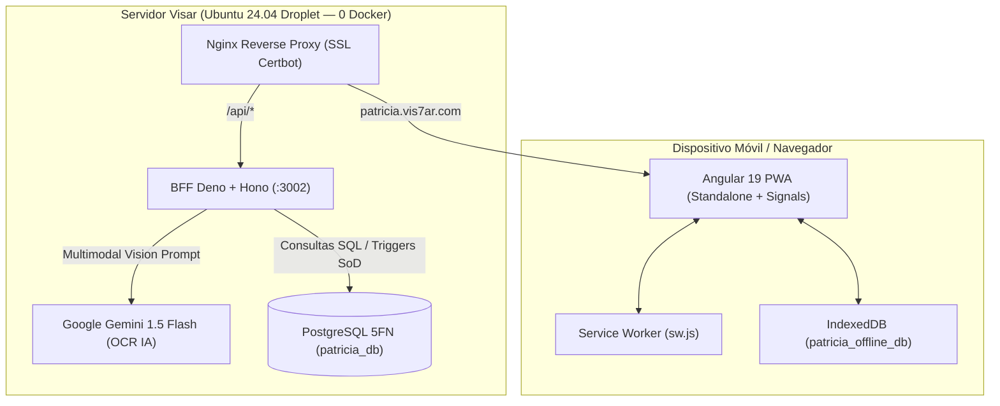

# 🧾 Patricia — Escáner Inteligente de Facturas y Recibos con IA

> **Patricia:** Aplicación Móvil PWA para Escaneo de Comprobantes Fiscales y Facturas DGII con IA Multimodal (Google Gemini Flash), Monitoreo Contable, Segregación de Funciones (SoD / Cuatro Ojos) y Arquitectura 5FN sobre Servidor Visar.

[](https://patricia.vis7ar.com)
[](https://patricia.vis7ar.com/api/v1/health)
[](https://github.com/250zero/patricia)
[](https://angular.dev)
[-000000?style=for-the-badge&logo=deno&logoColor=white)](https://hono.dev)
[](https://www.postgresql.org)

---

## 🚀 1. Accesos Directos a Producción

- 📱 **Aplicación PWA en Vivo:** [https://patricia.vis7ar.com](https://patricia.vis7ar.com)
- 🔌 **API REST / Health Check:** [https://patricia.vis7ar.com/api/v1/health](https://patricia.vis7ar.com/api/v1/health)
- 🖥️ **Subdominio de API:** [https://api.patricia.vis7ar.com/api/v1/health](https://api.patricia.vis7ar.com/api/v1/health)
- 📦 **Repositorio GitHub:** [https://github.com/250zero/patricia.git](https://github.com/250zero/patricia.git)

---

## 🔑 2. Credenciales y Matriz de Acceso (Usuarios Sembrados)

El sistema cuenta con **4 usuarios precargados** para cubrir la matriz completa de roles, permisos y pruebas de Segregación de Funciones:

| Rol | Correo Electrónico | Contraseña | Capacidades y Vistas Clave |
| :--- | :--- | :--- | :--- |
| **Super Admin** | `admin@patricia.vis7ar.com` | `Patricia2026!` | Acceso maestro (`*:*`), gestión de usuarios y roles (`/users`), acceso exclusivo a la **Bitácora de Auditoría en Tiempo Real**, y resolución de contingencias SoD. |
| **Contador** | `contador@patricia.vis7ar.com` | `Patricia2026!` | Bandeja contable (`/accounting`), **Visor de comprobantes con zoom y rotación 90°**, inserción de comentarios contables, dictamen (Aprobar/Rechazar) con **bloqueo estricto de auto-aprobación SoD**, y exportación **CSV con UTF-8 BOM**. |
| **Empleado 1** | `empleado1@patricia.vis7ar.com` | `Patricia2026!` | Captura con cámara/archivo (`/capture`), extracción con IA Gemini Flash, listado de gastos (`/expenses`) con **comentarios contables visibles**. |
| **Empleado 2** | `empleado2@patricia.vis7ar.com` | `Patricia2026!` | Captura y consulta de comprobantes propios para escenarios multi-usuario. |

> *Nota:* La pantalla de inicio de sesión dispone de botones de acceso rápido que rellenan automáticamente las credenciales de cada rol con un solo clic.

---

## 🎯 3. Características Principales

### 🧾 A. Escaneo Inteligente y Clasificación Fiscal RD (DGII)
- **Captura Dual:** Admite captura directa mediante la cámara trasera del dispositivo móvil (`environment`) o selección de imágenes desde la galería/archivos.
- **Extracción Multimodal con Google Gemini Flash:** Procesa imágenes de recibos y facturas en tiempo real extrayendo:
  - Nombre del comercio o proveedor.
  - Clasificación de documento: **Recibo Informal (`1`)** vs **Factura Fiscal Formal (`2`)**.
  - Validación de **RNC bajo el algoritmo Módulo 11** de DGII.
  - Validación de formato de **NCF tradicional (`B01..B16`)** y comprobantes electrónicos **e-CF (`E31..E47`)**.
  - Desglose aritmético: Subtotal, ITBIS (18%) y Total general con verificación de cuadre `subtotal + itbis == total`.
  - Desglose de líneas de detalle (ítems individuales).

### 🔍 B. Bandeja Contable e Inspección de Comprobantes (Requerimiento CS-01)
- **Visor Fotográfico Integrado:** El contador puede inspeccionar el comprobante físico en alta resolución junto con los datos extraídos, con controles de **rotación de 90° en 90° e inversión de zoom**.
- **Notas y Comentarios Contables Bidireccionales:** El contador puede registrar observaciones que se reflejan de inmediato tanto en la bandeja contable como en la tarjeta de **Gastos** del empleado emisor.
- **Segregación de Funciones (Principio de Cuatro Ojos):** La aplicación prohíbe que un contador apruebe o rechace un gasto emitido por sí mismo. El sistema arroja un error `403 SOD_VIOLATION` reforzado a nivel de base de datos con un trigger SQL.

### 📊 C. Exportación Contable Compatible con Microsoft Excel
- Descarga de libros auxiliares y reportes en formato CSV con el prefijo **UTF-8 BOM (`\uFEFF` -> `0xEF, 0xBB, 0xBF`)**, garantizando que Excel abra el archivo sin corromper tildes ni caracteres especiales, e incluyendo el tipo de documento y los comentarios contables.

### 📱 D. PWA Mobile-First con Modo Offline Seguro
- **100% Standalone & Signals en Angular 19:** Cero `NgModule`, componentes `OnPush`, control flow nativo (`@if`, `@for`), `<app-currency-input>` con `ControlValueAccessor` y `MoneyPipe` con `tabular-nums`.
- **Service Worker Seguro (`sw.js`):** Cache de app shell y activos estáticos (*Cache-First* con *Stale-While-Revalidate*). Las peticiones a `/api/*` y `/uploads/*` nunca se cachean para preservar la privacidad financiera y la vigencia de los tokens JWT.
- **Persistencia en IndexedDB (`patricia_offline_db`):** Los gastos se respaldan automáticamente en almacenamiento local para permitir consultas fluidas sin conexión con un **Banner animado de advertencia offline**.

### 🛡️ E. Bitácora de Auditoría Desacoplada (Super Admin)
- Inserción asíncrona no bloqueante de logs (`receipt_audit_logs`) con IP del cliente normalizada (`client_ip inet`), `user_agent`, entidad afectada y cambios JSONB.
- Panel visual interactivo en la pestaña de Super Admin para auditoría forense en tiempo real.

---

## 🏛️ 4. Arquitectura del Sistema



### 📐 Decisiones de Arquitectura (ADRs)

1. **ADR-001: Backend Ultraligero Deno + Hono en Puerto 3002 (0 Docker)**
   - *Contexto:* El droplet Visar ya aloja la aplicación Nora en el puerto 3001.
   - *Decisión:* Alojar Patricia como servicio nativo de Linux (`patricia-backend.service`) en el puerto 3002 gestionado por Systemd, logrando un consumo de memoria menor a 55 MB sin sobrecargar el VPS con contenedores Docker.
2. **ADR-002: Base de Datos en Quinta Forma Normal (5FN) y Enums Enteros**
   - *Contexto:* Evitar redundancias y asegurar integridad referencial en transacciones fiscales.
   - *Decisión:* Separación estricta entre comprobantes (`receipts`), líneas de detalle (`receipt_items`), comentarios (`receipt_comments`), roles (`roles`), permisos (`permissions`) y auditoría (`receipt_audit_logs`). Enums mapeados a enteros `smallint` (`1=Recibo, 2=Factura; 1=Borrador, 2=Enviado, 3=Aprobado, 4=Rechazado`).
3. **ADR-003: Autenticación WebCrypto Nativa HMAC-SHA256**
   - *Contexto:* Cero dependencias pesadas de Node para la firma de tokens JWT.
   - *Decisión:* Empleo directo de la Web Crypto API (`crypto.subtle`) integrada en el runtime de Deno para emisión y validación de tokens HS256.
4. **ADR-004: Segregación de Funciones (SoD) con Doble Candado**
   - *Contexto:* Requisito contable de que ningún revisor pueda aprobar sus propios comprobantes.
   - *Decisión:* Verificación en dos capas: validación en capa de aplicación (`accounting.service.ts`) con respuesta `403 Forbidden`, y trigger en PostgreSQL (`trg_check_sod_review`) que bloquea la transacción a nivel relacional.

---

## 📋 5. Respuestas a Preguntas Técnicas y Supuestos (Q1–Q18)

- **Q1 (Tolerancia en cuadres ITBIS):** Se configuró una tolerancia aritmética de `±0.05 DOP` para absorber redondeos de centavos en tasas proporcionales del 18%.
- **Q4 (Comprobantes sin NCF/RNC):** Se clasifican automáticamente como **Recibo Informal (`document_type = 1`)**, permitiendo su registro sin exigir validación DGII. Si se detecta un NCF formal (`B01` o `E31`), se clasifica como **Factura Fiscal (`document_type = 2`)** y se exige RNC válido.
- **Q6 (Acceso del Contador a Comprobantes):** El contador tiene visibilidad sobre todas las capturas de todos los empleados una vez que han sido enviadas (`status >= 2`).
- **Q13 (Segregación de Funciones):** Se implementó el principio estricto de Cuatro Ojos: un contador puede dictaminar los recibos de cualquier empleado, pero nunca los suyos propios.
- **Q17 (Exportación CSV):** Se incluye obligatoriamente el BOM UTF-8 (`\uFEFF`) para garantizar compatibilidad nativa con Microsoft Excel en español sin requerir asistentes de importación.

---

## 🧪 6. Suite de Pruebas Automatizadas

El proyecto incluye pruebas automatizadas que cubren las reglas de negocio, criptografía y validaciones fiscales:

```bash
# Ejecutar suite de pruebas en Deno
deno test --config backend/deno.json tests/unit_and_integration.test.ts
```

### Resultados de la Suite:
- ✅ **DGII:** Validación de RNC Módulo 11 (algoritmo con pesos ponderados).
- ✅ **DGII:** Validación de formato NCF formal y e-CF electrónico.
- ✅ **Contabilidad:** Cuadre Aritmético Subtotal + ITBIS (18%) == Total general.
- ✅ **Seguridad SoD:** Bloqueo de auto-aprobación del revisor (Cuatro Ojos).
- ✅ **Seguridad Auth:** Emisión, firma y verificación de tokens JWT con WebCrypto nativo.
- ✅ **Reportes:** Verificación de prefijo UTF-8 BOM (`\uFEFF`) en CSV para Microsoft Excel.

---

## 🛠️ 7. Guía de Despliegue DevOps (Servidor Visar)

### Requisitos Previos:
- Acceso SSH al servidor Visar (`159.203.103.8`) como usuario `root`.
- Llave SSH autorizada (`~/.ssh/id_ed25519_visar`).

### Despliegue Frontend y Backend:
```powershell
# Compilar PWA Angular, transferir estáticos y recargar servicios en Visar
powershell -ExecutionPolicy Bypass -File scripts\deploy-visar.ps1
```

### Despliegue de Base de Datos y Semillas:
```powershell
# Aplicar migraciones y semillas demo
powershell -ExecutionPolicy Bypass -File scripts\deploy-backend.ps1 -WithSeed
```

---

## 🔮 8. Roadmap de Producto y Futuros Features

Para las siguientes versiones de la plataforma Patricia se proyectan las siguientes extensiones funcionales de alto valor empresarial:
1. **Integración Nativa con Servicios Web de Facturación Electrónica DGII (e-CF):** Conexión directa mediante certificados digitales X.509 para consulta de TrackID y estatus de aprobación de comprobantes fiscales emitidos.
2. **Notificaciones Push Multicanal (Web Push / WhatsApp Business):** Alertas inmediatas a empleados cuando un comprobante es observado o rechazado por el contador, y recordatorios preventivos de cierre contable mensual.
3. **OCR Multi-Página y Procesamiento Asíncrono de PDFs:** Pipeline con workers de fondo para desglose y conciliación de facturas corporativas multi-página, órdenes de compra y estados de cuenta en PDF.
4. **Sincronización Bidireccional con ERPs (SAP, Odoo, Dynamics 365, QuickBooks):** Exportación automatizada de pólizas y asientos de diario contable mediante webhooks transaccionales y conectores REST/GraphQL.
5. **Geolocalización y Detección Automática de Viáticos:** Registro automático de coordenadas GPS durante la captura fotográfica para cotejar gastos de transporte, dietas y combustible contra políticas de kilometraje corporativo.
6. **Presupuestos y Alertas de Desviación por Centro de Costos:** Asignación de techos presupuestarios por departamento o proyecto con alertas preventivas al alcanzar el 80% del límite mensual.

---

## ⚡ 9. Mejoras Posibles y Optimizaciones de Arquitectura

1. **Caché Distribuido de Alto Rendimiento (Redis / Dragonfly):** Almacenamiento en memoria de catálogos contables, tasas de cambio oficiales del Banco Central (BCRD) y validaciones frecuentes de RNC para reducir la latencia de lectura en PostgreSQL.
2. **Cola de Mensajería Transaccional con Workers (RabbitMQ / PostgreSQL LISTEN/NOTIFY):** Desacoplar la ingestión pesada y preprocesamiento de imágenes hacia workers dedicados con reintentos exponenciales y Dead Letter Queues (DLQ).
3. **Preprocesamiento de Imágenes en el Edge (WebAssembly / Sharp en Navegador):** Compresión inteligente, auto-rotación por orientación EXIF y binarización adaptativa directamente en el dispositivo móvil antes de la transferencia HTTP, reduciendo drásticamente el consumo de datos celulares.
4. **Detección de Gastos Duplicados y Fraude con Embeddings (`pgvector`):** Vectores de similitud perceptual e informacional para detectar automáticamente recibos fotografiados más de una vez por distintos colaboradores o proveedores duplicados.
5. **Auditoría Avanzada con Trazabilidad Inmutable (WORM):** Sellado criptográfico periódico de `receipt_audit_logs` con hash encadenado SHA-256 hacia almacenamiento inmutable para cumplimiento normativo internacional (SOX / NIIF).

---

## 📄 10. Licencia y Gobernanza

Desarrollado bajo estándares empresariales de arquitectura limpia, patrones de alta disponibilidad y mejores prácticas de ingeniería de software para gestión financiera y cumplimiento fiscal.
